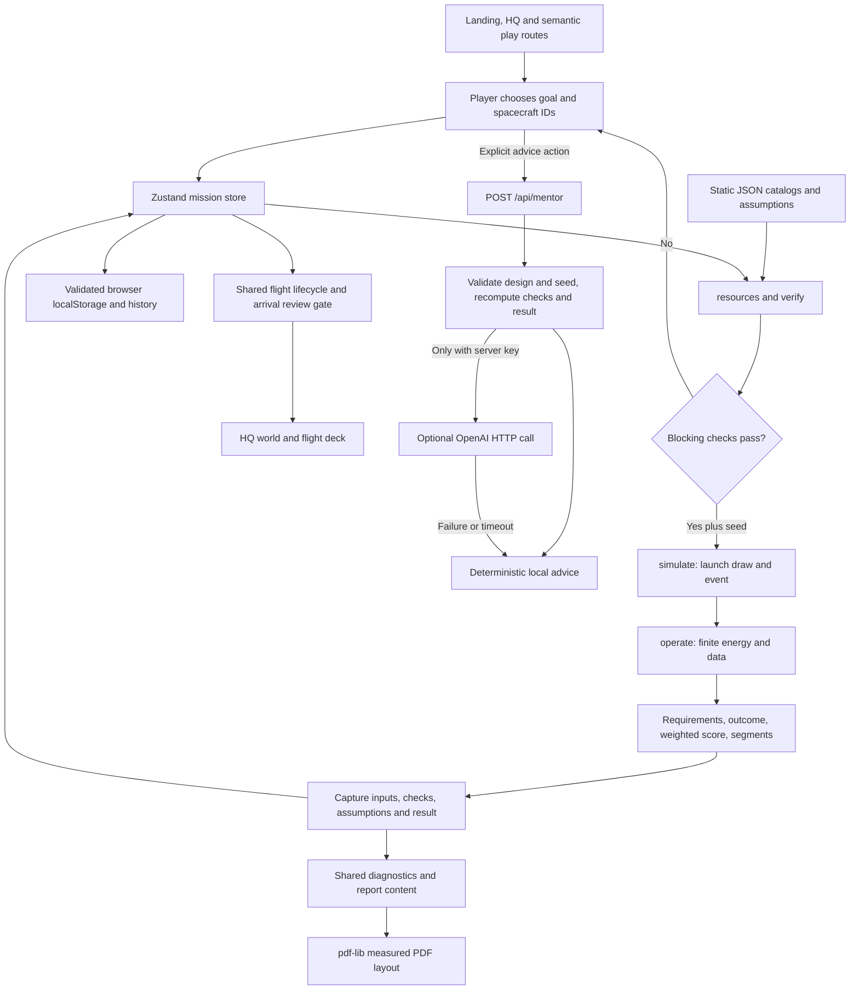

<p align="center"></p>

# MissionX — Design. Simulate. Learn.

**Design a spacecraft. Balance the trade-offs. Learn from the mission.**

MissionX is a single-player educational browser game by **[NASA WARRIORS](https://www.spaceappschallenge.org/2026/find-a-team/nasa-warriors/)**. Choose a science goal, assemble a spacecraft, balance its resources, verify the configuration, launch a repeatable seeded mission and discover why it succeeded, partially succeeded or failed.

[](package.json)
[](LICENSE)
[](package.json)
[](package.json)
[](package.json)


| Build a spacecraft | Understand its result |
|---|---|
|  |  |

**Version 0.1.12 · Implemented educational demonstration.** The complete local game loop is available; this is not a professional mission-analysis tool or an unconditional production/submission-readiness claim. Artwork permissions/SI disclosures, final team eligibility, the public short demo and exact deployed revision still need owner confirmation. A previously recorded moderate tooling advisory remains open; see [quality and security](#testing-and-quality-assurance).

[Existing public site](https://missionx-black.vercel.app/) · [GitHub repository](https://github.com/ausafulislam/MissionX) · [Submission drafts](submission/README.md)

The public URL is an existing deployment, **not proof that this repository revision is deployed**. The landing page was reachable during this review, but runtime/commit parity was not established. Screenshots and implementation descriptions below refer to repository version 0.1.12, not a claimed new rollout.

## Contents

- [Challenge and team context](#challenge-and-team-context)
- [Problem, solution and vision](#problem-solution-and-vision)
- [What makes MissionX different](#what-makes-missionx-different)
- [Core features](#core-features)
- [Complete player journey](#complete-player-journey)
- [Available missions](#available-missions)
- [Mission design and spacecraft building](#mission-design-and-spacecraft-building)
- [Verification and validation system](#verification-and-validation-system)
- [Launch simulation and results](#launch-simulation-and-results)
- [Scientific foundation and resource mapping](#scientific-foundation-and-resource-mapping)
- [Scientific assumptions and limitations](#scientific-assumptions-and-limitations)
- [Technical architecture](#technical-architecture)
- [Technology stack](#technology-stack)
- [Repository structure and module guide](#repository-structure-and-module-guide)
- [Game engine explained](#game-engine-explained)
- [Data architecture and configuration](#data-architecture-and-configuration)
- [AI Mentor and environment configuration](#ai-mentor-and-environment-configuration)
- [Testing and quality assurance](#testing-and-quality-assurance)
- [Installation and local development](#installation-and-local-development)
- [Build and deployment](#build-and-deployment)
- [Screenshots and visual demonstrations](#screenshots-and-visual-demonstrations)
- [Credits and attribution](#credits-and-attribution)
- [Independence disclaimer](#independence-disclaimer)
- [Team information](#team-information)
- [License and participation](#license-and-participation)

## Challenge and team context

| Item | Verified project context |
|---|---|
| Event | [2026 NASA International Space Apps Challenge](https://www.spaceappschallenge.org/2026/), November 14–15 |
| Selected challenge | [Space Mission Design Game](https://www.spaceappschallenge.org/2026/challenges/space-mission-design-game/) |
| Event theme | **The Next Frontier** — the event theme, not the challenge title |
| Team | **[NASA WARRIORS](https://www.spaceappschallenge.org/2026/find-a-team/nasa-warriors/)**, Karachi, Pakistan; public page lists Universal Event |
| Implemented response | A complete single-player design/resource/simulation/evaluation loop; the challenge's suggested collaborative mode is not implemented |
| Participation evidence | Public team content is participant-generated, not NASA review, endorsement or proof of a completed submission |

The official [Submission Guide](https://www.spaceappschallenge.org/resources/project-submission-guide/) calls for a public demo of **at most seven slides including title/intro OR a video at most 30 seconds**, alongside required project fields and references. The [Judging & Awards Guide](https://www.spaceappschallenge.org/resources/judging-awards-guide/) names Impact, Creativity, Validity, Relevance and Presentation. Universal Event eligibility requires 2–6 registered same-event members; the submission deadline uses the Team Owner's residence timezone. These are owner-verification tasks, not claims of eligibility or submission. The local storyboard is not a finished deck/video.

## Problem, solution and vision

### The problem

Learning isolated facts about rockets, spacecraft and planets does not necessarily explain how a complete mission fits together. The selected challenge highlights the gap: a more capable instrument may also demand more mass, power, storage, communications and budget. Improving one subsystem can make the overall mission less feasible.

### Our solution and why we built it

MissionX makes those linked decisions playable. Rather than only watching a launch, the player chooses a science goal, builds within constraints, inspects a live engineering balance, resolves checks and evaluates returned science. A launch can fail despite a ready design; a spacecraft can arrive but lose useful observations because memory, power or downlink was insufficient. Reports expose those consequences and support another design attempt.

### Vision and objectives

The intended audience is students, educators and curious beginners. We aim to:

- Connect scientific objectives to measurable configuration requirements.
- Make subsystem/resource trade-offs visible before and after launch.
- Encourage iteration, comparison and explanation rather than a single “correct” build.
- Distinguish modeled evidence from unmodeled physical properties.
- Offer an engaging 3D headquarters and a semantic flight-deck alternative without registration.

These are educational objectives, **not measured learning outcomes**. No classroom study, adoption metric or demonstrated improvement in test scores is claimed.

## What makes MissionX different

These are strengths of this implementation, not claims that no similar tool exists:

- **One connected loop:** goals, component choices, resource consequences, configuration checks, seeded risk, operations and a detailed report.
- **Science depends on data reaching Earth:** generated, transmitted, received, discarded and still-onboard data are tracked separately.
- **Two presentations of the same rules:** procedural HQ scenes and the `/play` flight deck share the TypeScript engine instead of maintaining separate simulations.
- **Explicit uncertainty:** unmodeled measurements stay **NOT EVALUATED**; acknowledging a review does not turn it into a sensor test.
- **Inspectable records:** new runs capture inputs, assumptions, checks and results; legacy reconstructions are labeled rather than presented as recovered originals.
- **Outcome is not the rounded score:** a weighted score of 100 can coexist with PARTIAL if a final requirement was narrowly missed.

## Core features

| Feature | What exists now |
|---|---|
| Three mission scenarios | Moon Mapping, Sun Watch and Mars Orbiter, with different fleet/resource/lifetime constraints |
| Spacecraft design | 26 authored parts across eight categories; mission compatibility, dependencies, payload allowance and baseline assemblies |
| Launch/orbit selection | Three fictional launch services and six synthetic orbit configurations; reachability and science suitability checked separately |
| Live resource monitor | Fleet mass/cost/data/storage/downlink; per-spacecraft power and battery; weakest-component lifetime |
| Verification | Blocking requirements, explicitly nonblocking operational risks and margin advisories |
| Mission playback | Shared 3–2–1/LIFTOFF, seeded launch/event outcomes, schematic journey, pause/speed/skip and six arrival reviews |
| Results | SUCCESS/PARTIAL/FAILED; science, engineering and efficiency contributions; four mission segments and redesign advice |
| Local records | Up to 12 history entries, comparison/debrief, commander preferences/progression and captured-input report provenance |
| Reports | In-app detailed review and downloadable multi-page PDF with checks, balance, events, outcomes and parameter provenance |
| Guidance | First-use HQ tour, replay from settings, deterministic local advice and optional remote AI Mentor |
| Presentation/fallback | Procedural 3D, no-WebGL compatibility controls, semantic alternative, reduced-motion preferences and gesture-started procedural audio |

**Not implemented:** multiplayer, cloud accounts/sync, leaderboard, Urdu localization, GMAT, live NASA/CSA APIs or telemetry, real orbit propagation, real spacecraft control, physical subsystem certification, or an offline-installable PWA. The availability of fallback controls is not full accessibility or physical-device certification.

## Complete player journey

**GOAL → BUILD → VERIFY → LAUNCH → RESULT → REDESIGN**

1. **Enter:** open the landing page, then `/hq`. Choose a local display name, complete/skip the tour and visit stations. Use `/play/goal` for the semantic flight deck.
2. **Choose a goal:** inspect the mission's mass, budget, science and lifetime requirements. Read the mission context and authored-estimate disclosure.
3. **Build:** select a structure, power, battery, communications, computer, attitude control and mission payload; optionally load the authored baseline. Watch the engine-derived resource monitor change.
4. **Verify:** choose a reachable, science-compatible orbit and launcher. Resolve blocking failures. Read warnings: permission to attempt launch is not a promise of full science return.
5. **Launch:** choose an integer flight seed, begin the countdown and watch compressed playback. Repeat the same design/seed/model/catalog inputs to reproduce the calculated outcome.
6. **Review arrival:** a deployed spacecraft reaches six sequential configuration reviews. Inspect evidence and missing measurements before continuing to science operations. Launch loss earns no arrival credit.
7. **Evaluate:** read outcome, unmet requirements, weighted score, returned science, lifetime and segment explanations. Download the report; compare saved attempts and redesign.

**Quick walkthrough:** Moon → authored baseline → Swift Light → Lunar polar orbit → seed **5**. Repository evidence records SUCCESS/100. For contrast, Moon seed **0** is PARTIAL/100 with **44.9/45 science**, and seed **43** loses the launch. These are deterministic educational examples, not real launch statistics.

## Available missions

All numerical inputs below are **MissionX-authored educational estimates**. Fleet mass and budget are totals; budget includes fleet parts plus one launch. Science is a gameplay points proxy, not a quantity of discoveries. Lifetime is months.

| Mission | Difficulty label | Craft | Mass limit | Budget ($M) | Science target | Required life |
|---|---|---:|---:|---:|---:|---:|
| Moon Mapping | Beginner | 1 | 550 kg | 85 | 45 points | 12 months |
| Sun Watch | Intermediate | 4 identical | 1,000 kg | 180 | 160 points | 12 months |
| Mars Orbiter | Advanced | 1 | 900 kg | 170 | 75 points | 24 months |

### Moon Mapping

- **Scenario/goal:** configure a lunar imaging orbiter that meets the science target and survives synthetic shadow/contact cycles. Lunar mapping is the real mission concept; coverage/resolution/discoveries are not physically calculated.
- **Choices:** camera plus the six essential platform categories; optional compatible science payload. Baseline uses Sparrow bus, compact array, small battery, basic radio/computer/attitude and mapping camera (`setup.json` IDs are authoritative).
- **Verification:** camera required; Lunar polar orbit is the science destination. Swift Light, Atlas Medium or Horizon Heavy can reach it, subject to fleet mass and budget.
- **Learning/outcome:** balance imaging value against power, memory and contact-limited reception. Arrival alone is insufficient; final returned science and lifetime still determine outcome.
- **Context:** NASA LRO is a linked lunar-science example, **not the source of this spacecraft's mass, cost or capability**.

### Sun Watch

- **Scenario/goal:** four identical small satellites observe the solar corona **from Earth orbit**. This is not a journey to the Sun and not a physical constellation-coverage model.
- **Choices:** coronagraph required; common six-category platform replicated across four craft. The baseline uses the light platform and basic subsystems with a coronagraph. Fleet cost/mass/data multiply, while energy feasibility is checked per craft.
- **Verification:** Sun-observing Earth orbit, SSO or GEO teaching options, and a launcher that actually reaches the selected orbit. Atlas Medium reaches the baseline `solar` option; Swift Light can reach SSO, not `solar`.
- **Learning/outcome:** scaling a spacecraft multiplies resources, but a synthetic long eclipse can still defeat a seemingly favorable contact fraction. Received fleet observations and final requirements determine success, not merely deployment of four visuals.
- **Context:** NASA PUNCH supplies the four-spacecraft/solar-observation theme; MissionX's identical spacecraft and parameters are not a PUNCH hardware model.

### Mars Orbiter

- **Scenario/goal:** image/study Mars under weaker authored sunlight and shorter synthetic ground contacts, with a longer life requirement. No interplanetary transfer is solved.
- **Choices:** camera required; baseline combines deep-space bus/array, large battery, deep-space radio, radiation-tolerant computer, precision attitude, high-resolution camera and spectrometer.
- **Verification:** Mars science orbit requires Horizon Heavy in the current catalog. Check payload dependencies/allowance, energy reserve, data recovery and 24-month component life as well as mass/budget.
- **Learning/outcome:** higher-capability instruments need a supporting power/data/pointing platform. Launch and one authored operational incident can still reduce final science or life.
- **Context:** NASA MRO provides Mars-imaging/science context; no real MRO specifications, RF link solution or imaging calibration are imported.

## Mission design and spacecraft building

The design is a small record: `missionId`, selected `partIds`, `rocketId` and `orbitId`. The UI selects IDs; catalogs define their properties; the engine derives consequences.

| Category | Role and trade-off |
|---|---|
| Structure | Bus mass/cost/lifetime and camera/science payload mass allowance |
| Power | Solar generation versus mass/cost and end-of-life degradation |
| Battery | Stored eclipse energy; usable capacity is less than nameplate capacity |
| Communications | Downlink capacity, power draw and mission compatibility |
| Computer | Onboard storage/lifetime; protected option mitigates a specific authored storm effect |
| Attitude control | Instrument pointing dependencies; no actual attitude dynamics |
| Camera | Required for Moon/Mars; stronger imaging payload can increase data/load |
| Science instruments | Distinct compatible instruments may be combined within resource/payload constraints |

One part per non-science category is supported; multiple distinct science instruments are allowed. Duplicate/unknown IDs and incompatible/dependency-violating combinations are rejected. Zero-valued catalog fields do not imply a real component has no corresponding physical demand.

**Fictional launchers:** Swift Light (600 kg, $18M, 0.96 reliability), Atlas Medium (1,600 kg, $35M, 0.975) and Horizon Heavy (2,600 kg, $58M, 0.985). These are authored game services, not real provider specifications. One launch carries the mission fleet.

**Synthetic orbit catalog:** Low Earth staging (`earth`, no mission science), Lunar polar (`lunar`, Moon), Sun-observing Earth (`solar`, Sun), Mars science (`mars`, Mars), Sun-synchronous Earth (`sso`, Sun), Geostationary Earth (`geo`, Sun). Period, contact, eclipse and solar factors are inputs to repeating schedules, not calculated trajectories/visibility. Reachable does not automatically mean science-compatible.

## Verification and validation system

There are three different kinds of validation; none is professional mission certification:

1. **Input/save validation:** `schema.ts`, `snapshot-schema-v1.ts` and store hydration check structure, catalog IDs, bounds, versions and corrupted records.
2. **Prelaunch engineering rules:** `validation.ts` combines four mission requirements with generation/load, eclipse energy, daily downlink, inter-contact memory, launcher capacity, subsystem/payload presence, instrument dependencies, bus payload allowance, category slots, orbit and trajectory compatibility.
3. **Arrival configuration review:** `diagnostics.ts` groups available configuration evidence into spacecraft health, power, communications, orbit/navigation, instruments and readiness.

A near numeric miss may be labeled `close`, but is **still blocking unless explicitly nonblocking**. Nonzero insufficient storage/downlink can be an accepted warning; zero capacity does not receive that exception. Mass/EOL-power headroom advisories use an authored 10% threshold. “Low/moderate/high risk” is a heuristic label, not a failure probability.

The shared aggregate is **FAIL > WARNING > NOT EVALUATED > PASS**; an empty aggregate is NOT EVALUATED. Mixed warning/unmodeled groups retain the warning and disclose missing findings. UI and PDF show separate group and finding counts; repeated findings are instances, not unique sensor measurements. Baseline arrival has four incomplete groups/six unevaluated finding instances.

Six acknowledgments gate science playback, not hardware qualification. Real propulsion/thermal health, RF acquisition/link compatibility, insertion/navigation accuracy and instrument calibration remain **NOT EVALUATED**. CONFIGURATION READY or a presence-check PASS must not be read as flight certification.

## Launch simulation and results

`simulate()` calculates the result when the store accepts launch. The playback subsequently presents that result; moving the camera or acknowledging a review does not change the science calculation.

- The first seeded random draw checks the selected fictional launcher's reliability after verification.
- A lost launch ends at playback second 7: no arrival, no operational data, zero score.
- A surviving launch has separation at 8, deployment at 13, operations/arrival review at 18, one event at 23 and evaluation at 30 compressed seconds.
- The operational event is one of storm, ground outage, instrument fault or stable operations, each selected with an authored 25% share. Protected computer/radio choices modify particular effects.
- The shared clock shows three 0.8-second beats and a 0.6-second LIFTOFF hold before ascent at second 3. Skip cannot bypass the initial countdown or six-review gate.

### Outcome and Weighted Performance Score

The final four requirements are fleet mass, total budget, achieved science and achieved lifetime. SUCCESS requires all four plus effectively full energy availability; launch loss or less than half the science target is FAILED; other completed cases are PARTIAL.

| Contribution | Current authored rule |
|---|---|
| Science score | Rounded, capped science/target × 100 |
| Engineering score | Rounded mean of energy availability and capped achieved/required life × 100 |
| Efficiency score | Rounded/clamped budget headroom with a 0.55 offset, multiplied by capped science attainment × 100 |
| Weighted Performance Score | Rounded 50% science + 35% engineering + 15% efficiency; zero after launch loss |

**100 does not necessarily mean every objective was achieved.** Rounding is independent of the outcome requirements. Moon baseline seed 0 returns 44.9/45 science and PARTIAL despite a weighted score of 100. Read the outcome and unmet requirements, not only the number.

The report also explains **LAUNCH / SPACE / GROUND / USER** segment status. These are evidence/reason groups, not four separately awarded scores. Science credit requires Earth-received observations; storage overflow and onboard backlog do not earn credit. Results include recommendations and a PDF, generated locally rather than uploaded to a report service.

## Scientific foundation and resource mapping

### How to read the evidence

The following **16 research/interaction references** are present in existing project records: the nine requested resources, three mission-context pages, two Quicksat guides, the community Mission Architect guide and W3C dialog guidance. Original URLs were re-opened for this README review on **2026-11-14** with the limited scopes described below. Reaching a page is not the same as reading an entire manual, executing a game/solver or proving historical influence.

- **Conceptual/educational reference:** explicitly cited content or a relevant comparison; not adopted numerical parameters.
- **Researched/mentioned only:** recorded reading, with no demonstrable direct feature adoption.
- **Implemented independently:** MissionX's own TypeScript/geometry, not imported agency code.
- **Actual dependency/API:** demonstrable imports or an HTTP call, listed separately under technology/mentor. No NASA/CSA software/API integration is established.

The “related code” column identifies a real correspondence or disclosure boundary. **It does not upgrade a merely researched resource into the origin of that code.** Historical method adoption is unknown unless specifically established; no external source is asserted as the derivation of catalog numbers.

### NASA and CSA resources — the nine requested references

| Resource / reviewed scope | What the resource explains | Related MissionX concept | Where reflected | How used / adaptation | Relationship type |
|---|---|---|---|---|---|
| [NASA Design and Develop Science Missions — Julie Levri, 2025](https://www.nasa.gov/wp-content/uploads/2025/04/250323-design-and-develop-science-mission.pdf?emrc=a454cf); “What segments…”, “Big Picture Process”, ConOps/BioNutrients examples in first extracted chunk | Science goals, requirements, design/verify/implement and Launch/Space/Ground/User segments | Requirement-driven workflow and four segment explanations | `src/game/engine/validation.ts`, `src/game/engine/simulation.ts`; explicit citation in `src/game/report/mission-report.ts` | Current conceptual citation; independent educational checks, not implementation of NASA procedures or numerical derivation | **Conceptual reference**; high confidence in cited correspondence, historical adoption unproven |
| [NASA GMAT R2025a catalog](https://software.nasa.gov/software/GSC-19468-1); overview/software details | Professional mission design, optimization and navigation across orbital regimes | Boundary between real trajectory analysis and schematic playback | `docs/RESOURCES.md`; contrast with `src/components/hq/world/journey-geometry.ts` | Studied catalog only; not installed, executed, imported or connected; no trajectory file ingestion | **Researched/mentioned only; no GMAT integration** |
| [JPL Concept Maturity Levels — Wessen et al., 2013](https://dataverse.jpl.nasa.gov/dataset.xhtml?persistentId=hdl:2014/44299); repository abstract/metadata, not full paper | Incremental assessment of mission-concept maturity; early CML 1–4 | Useful comparison for how much analysis remains beyond a game configuration | `docs/RESOURCES.md`; no CML engine module | Literature context, not a copied matrix, game score or official CML rating | **Researched/mentioned only**; paper-level adoption not established |
| [NASA Mission Design Lab](https://etd.gsfc.nasa.gov/capabilities/integrated-design-center/mission-design-lab/); Provides/Study Options/Capabilities/Disciplines | Collaborative engineering and cross-discipline mass, power, data, cost and risk trades | Comparison with MissionX's bounded subsystem trade-offs | `docs/RESOURCES.md`; related independent `src/game/engine/resources.ts` | No MDL tools, studies, cost products or certification adopted; similarity is not proof of influence | **Professional/educational comparison only** |
| [NASA Mission Viz](https://nasa.github.io/mission-viz/); apps/tutorial index, demos not run | Web-based orreries and orbital visualization tutorials | Context for presenting a mission in a browser | Historical descriptive ID in unused `src/game/data/flight-stages.json`; `docs/RESOURCES.md` | Runtime geometry is locally authored; no NASA propagator, X3D/X3DOM or Mission Viz code imported | **Researched/mentioned only; independent visualization** |
| [NASA Webb Build It Yourself](https://science.nasa.gov/mission/webb/game-build-it-yourself/); learning-game introduction, not a play-through | Science requirements drive wavelength, instrument and optics choices | Educational comparison with choosing a goal before building | `docs/RESOURCES.md`; related independent `src/components/game/goal-screen.tsx` and `build-screen.tsx` | No verified direct design adoption, copied game content or shared implementation | **Educational reference only** |
| [NASA CubeSat 101](https://www3.nasa.gov/sites/default/files/atoms/files/nasa_csli_cubesat_101_508.pdf); introduction, §1.1/start §1.2, not full manual | First-time developer context, standardized small spacecraft and deployment interfaces | Comparison with modular small-spacecraft design | `docs/RESOURCES.md`; `src/game/data/parts.json` contains authored `bus-cube` | No CubeSat U-size/dispenser/interface conformity, qualification or coefficient derivation implemented | **Researched/process reference only** |
| [Space Apps 2023 Visualize a Space Mission Using Virtual Reality](https://www.spaceappschallenge.org/2023/challenges/visualize-a-space-mission-using-virtual-reality/); summary/background/objectives/considerations | Interactive browser visualization; optional tools such as GMAT and digital globes | Historical challenge context, not the 2026 task | `docs/RESOURCES.md`; contrast with current `src/components/hq/world/` | No demonstrated direct adoption; browser 3D here is not WebXR/VR or GMAT | **Historical reference only** |
| [Canadian Space Agency Digital Games and Activities](https://www.asc-csa.gc.ca/eng/youth-educators/digital-games-and-activities.asp); directory descriptions, games not played | Space-learning games/activities for varied audiences | Educational-medium comparison | `docs/RESOURCES.md`; no CSA runtime module | No CSA activity, image, dataset or API incorporated; no verified direct feature influence | **Educational directory reference only** |

### Additional mission, engineering and interaction references

| Resource / reviewed scope | What it explains | Related MissionX feature | Where reflected | Actual use / boundary | Relationship type |
|---|---|---|---|---|---|
| [NASA Lunar Reconnaissance Orbiter](https://science.nasa.gov/mission/lro/); mission introduction/mapping context | Lunar surface investigation and mapping | Moon Mapping science theme | `src/game/data/missions.json` reference → `src/components/game/result-screen.tsx` external mission link | Real mission for further reading; no hardware numbers, imagery or data ingested | **Explicit mission-context reference** |
| [NASA PUNCH](https://science.nasa.gov/mission/punch/); mission introduction | Four small satellites observing the corona/heliosphere from Earth orbit | Sun Watch fleet/theme and Earth-orbit wording | `src/game/data/missions.json`, `orbits.json`; `src/game/engine/flight-lifecycle.ts` destination label | Concept correspondence; identical craft, authored capacities and synthetic schedules are not PUNCH specifications | **Explicit mission-context reference** |
| [NASA Mars Reconnaissance Orbiter](https://science.nasa.gov/mission/mars-reconnaissance-orbiter/); mission introduction | Mars science and evidence of persistent surface water | Mars imaging/science theme | `src/game/data/missions.json` reference → result-screen mission link | Context only, not real camera calibration, orbit/link design or specifications | **Explicit mission-context reference** |
| [Quicksat: Set up a power budget](https://github.com/egemenimre/quicksat/blob/master/docs/guides/power/set_up_a_power_budget.md); §§5–8 | Battery/conditioning accounting and energy/load checks | Conceptual comparison for generation, stored energy and losses | Explicit report citation in `src/game/report/mission-report.ts`; independent `resources.ts`/`operations.ts` | No Python library import or proved derivation of matching coefficients; community, not agency authority | **Conceptual reading reference** |
| [Quicksat: Initialise a satellite](https://github.com/egemenimre/quicksat/blob/master/docs/guides/sizing/initialise_a_satellite.md); dataflow config/loading/checking | Instrument generation, contact inputs, downlink, storage and coupled budgets | Explaining finite data/storage/contact budgets | Link in `src/components/game/operations-note.tsx`, report citation; independent `operations.ts` | No Quicksat delta-v/agility engine or adopted numeric model; actual historical derivation unknown | **Conceptual reading reference** |
| [IDEAMAX Skills Factory: Mission Architect](https://github.com/devideamax/aerospace-team/blob/main/skills/mission-architect/SKILL.md); front matter/role/overview only | Generated community guide describing systems-budget/review roles | Historical engineering-audit reading, not an agency standard | `docs/Engineering-Audit.md`, `docs/RESOURCES.md` | No direct feature/numerical adoption established; upstream attribution requirements are not waived by linking | **Historical mention only** |
| [W3C APG Modal Dialog Pattern](https://github.com/w3c/aria-practices/blob/main/content/patterns/dialog-modal/dialog-modal-pattern.html); About/Keyboard Interaction | Modal background inertness, contained focus and focus movement | Interaction-pattern correspondence for overlays/tour | `src/components/hq/focus-guard.tsx`, `tutorial-tour.tsx`; landing dialog has its own controls | Local implementation corresponds to guidance; no historical-copy claim or accessibility certification | **Conceptual interaction reference** |

### Competition and software references are different evidence

The five official administrative pages linked in [challenge context](#challenge-and-team-context)—2026 event, selected challenge, team, Submission Guide and Judging Guide—inform scope, identity and submission drafts, **not engine numbers**. Their actual local consumers are `submission/OFFICIAL_REQUIREMENTS.md`, `TEAM_INFORMATION.md`, `SUBMISSION_CHECKLIST.md` and this README. Member eligibility, full legal acceptance and final submission were not authenticated or performed here.

Software technical references in the existing source register cover Three.js math/camera, R3F/Drei, Next/React, Zustand, GSAP, Lenis, pdf-lib, Tailwind, TypeScript, Bun and the optional OpenAI endpoint. Those packages/API have demonstrable use listed below; their presence is not scientific evidence. Bundled font notices and unknown artwork rights are covered under [credits](#credits-and-attribution).

**Evidence confidence:** high for inspected local imports/catalogs and the named retrieved passages; limited for unexecuted upstream tools/games and original historical design influence. Linked papers, manuals, example code and images can have separate terms. This README does not grant permission to copy them. The full source register and field records remain available in `docs/RESOURCES.md`, `docs/ENGINEERING_REFERENCES.md` and `docs/DATA_SOURCES.md`.

## Scientific assumptions and limitations

### What the model actually represents

The scientifically recognizable ideas are system trade-offs, requirements, finite energy, finite memory, intermittent contact and science value requiring delivered observations. **Their implementation and magnitudes are educational approximations, not NASA-validated predictions.**

| Input/model policy | Actual assumption |
|---|---|
| Catalog specifications | Mass/cost/draw/generation/battery/storage/data/downlink/science/lifetime, payload allowances and compatibility are authored; original balancing rationale is not recorded |
| Solar availability | Orbit solar factor × daylight fraction × 0.98 annual retention raised to required life in years |
| Battery | 0.80 usable fraction × 0.95 discharge allowance; charge efficiency 0.95; no temperature/rate/cycle-aging model |
| Operations | Four representative end-of-life days, 48 midpoint steps per authored orbit, constant loads, initially full usable battery/empty memory |
| Contact/reception | Repeating synthetic windows; reception efficiency 1; no RF budget, interference, latency, packet errors or real station geometry |
| Fleet | Identical craft; energy per craft, data/memory aggregated for fleet; no inter-satellite networking/coverage solution |
| Campaign totals | Representative daily rates × lesser of achieved/required lifetime × 30 days/month; not evolving full-life integration |
| Risk/score | Fictional launcher reliability, event shares/factors, margin thresholds, points and reward weights are authored game policy |
| Visualization | Geometry, planets, formation spacing, altitude/velocity labels and compressed travel time are schematic, not measured/propagated |

Parameter provenance is recorded in catalog `source` objects (`title`, URL, parameter, accessed date, confidence and simplification), assumptions JSON and report parameter IDs/units. Mission `reference` links are separate thematic references, **not numeric citations**. Snapshots identify which authored values were captured; source descriptions/report logic can still be current metadata. A recorded access date or schema checksum is not scientific validation.

### What MissionX does not claim

- Real orbital propagation, transfer design, ephemerides, navigation/insertion accuracy or **GMAT integration**.
- Live NASA/CSA APIs, live telemetry or actual spacecraft control.
- Real RF communication, antenna compatibility/acquisition or ground-network scheduling.
- Propulsion/delta-v/fuel sizing, thermal/radiation/structural/vibration/attitude dynamics.
- Calibrated instruments, geographic coverage/resolution, physical discoveries or hardware-health measurements.
- Actual flight certification, NASA endorsement, official concept-maturity rating or verified launch reliability.
- Convergence/initial-state sensitivity studies, independent physical validation or measured educational efficacy.

A PASS is an implemented rule/presence check, not proof of unmodeled health. Energy/data ledgers are internally testable accounting; their conservation does not make the scenario physically validated. [Detailed limitations](docs/Scientific-Limitations.md) retain the full boundaries.

<a id="technology-and-architecture"></a>

## Technical architecture

The frontend has two game presentations. Static JSON defines scenario options; the pure TypeScript engine calculates rules/results; Zustand owns client state and persistence. UI controls select IDs, display outputs and control playback. The only application server API is optional mentor advice.



**Responsibility boundaries:** the engine imports data/types, not React/UI. Catalogs do not calculate outcomes. Rendered spacecraft/planet poses do not feed back into resources or score. `flight-lifecycle.ts` controls presentation eligibility/timing; `diagnostics.ts`/`flight-tests.ts` provide one evidence/severity projection to panels and reports. Reports use captured inputs when available, not invented archived measurements.

No application database, authentication, cloud-save service, queue, multiplayer server or NASA integration exists. Local display names are not authenticated identities. The original protected architecture document includes older plans; the description here follows the current implementation rather than treating those plans as shipped features.

## Technology stack

Versions below are resolved from the current package/lock installation. “Why” describes the role served in this code, not an undocumented historical technology-selection study. These are actual installed tools, not considered alternatives.

| Technology | Role / why it is useful here | Implementation evidence |
|---|---|---|
| Next.js 16.4.6 | App Router pages/layouts, assets and a server-only optional advice endpoint in one app | `src/app/`, `next.config.ts`; cache components/partial prefetching enabled |
| React / React DOM 19.3.0 | Composable interactive screens, hooks and browser rendering | `src/components/`, `src/hooks/` |
| TypeScript 5.9.3 | Strict shared models and pure engine contracts | `src/game/types.ts`, `tsconfig.json`; compile-time checks, not runtime validation by themselves |
| Tailwind CSS / Turbopack loader 4.3.3 | Utilities integrated with Next's CSS build; scoped CSS provides game/HQ styling | `next.config.ts`, `src/app/globals.css`, route styles |
| GSAP 3.15.1 / @gsap/react 2.1.2 | Scoped motion/timelines and React cleanup | `src/components/landing/motion.tsx`, game/HQ animation hooks; custom GSAP license |
| Lenis 1.3.27 | Landing-only smooth scroll synchronized with motion | `src/components/landing/motion.tsx`; game routes retain native scroll |
| Three.js 0.187.0 | Procedural geometry, camera math and scene rendering | `src/components/hq/world/`; Vector3/Quaternion/camera use, not a physics solver |
| React Three Fiber 9.8.2 / Drei 10.7.9 | React Canvas lifecycle and scene helpers | `src/components/hq/world/world.tsx` and scene modules |
| Zustand 5.1.0 | Shared client mission/profile state for both game presentations | `src/game/store/mission-store.ts`, `commander-store.ts` |
| pdf-lib 1.17.1 | Browser-local document construction and measured text/table layout | `src/game/report/pdf-export.ts`, `pdf-layout.ts` |
| Web Audio / browser APIs | Procedural score/cues after gesture; local storage, fullscreen/orientation fallbacks | `src/game/audio/`, `src/components/hq/device.ts`; browser facilities, not added SDKs |
| OpenAI HTTP API (optional) | Additional plain-text mentor explanation with a local fallback | `src/app/api/mentor/route.ts`; **no OpenAI SDK installed** |
| Bun 1.3.14 | Pinned package manager, scripts and test runner | `package.json`, `bun.lock`, colocated `*.test.ts` |
| ESLint 9.39.5 / eslint-config-next 16.4.6 | Static linting; DefinitelyTyped packages supply Node/React/Three type declarations | `eslint.config.mjs`, `package.json` |

Sharp is already resolved transitively through Next and used by the existing PDF-logo developer script; it is not a newly added direct runtime dependency. No external audio recordings, downloaded 3D spacecraft models or remote-font SDK are required by the procedural implementation.

## Repository structure and module guide

This tree is based on tracked files, not a proposed layout. Large groups are deliberately grouped; the tables immediately below explain important files and consumers. The game engine lives under `src/game/engine`. Most tests are colocated, not under the root `tests/` directory.

```text
MissionX/
├── .github/
│   ├── ISSUE_TEMPLATE/{bug_report,documentation,feature_request}.yml
│   ├── ISSUE_TEMPLATE/config.yml
│   └── pull_request_template.md
├── public/
│   ├── fonts/                         # Four local families and OFL notices
│   ├── images/                        # logo, logo-report, orbital-hero, lunar-mission PNGs
│   └── textures/.gitkeep              # Placeholder; not a NASA texture dataset
├── scripts/
│   ├── balance.ts
│   └── pdf-logo.ts
├── src/
│   ├── app/
│   │   ├── layout.tsx, page.tsx, error.tsx, not-found.tsx, icon.svg
│   │   ├── globals.css, game-feel.css
│   │   ├── api/mentor/route.ts
│   │   ├── hq/{page.tsx,hq.css}
│   │   └── play/
│   │       ├── layout.tsx, page.tsx, error.tsx, game.css
│   │       └── {goal,build,verify,launch,result,debrief}/page.tsx
│   ├── components/
│   │   ├── sections/                  # Landing composition and content
│   │   ├── layout/                    # Site header/footer
│   │   ├── landing/                   # Briefing data/dialog and motion wrapper
│   │   ├── game/                      # Flight-deck screens and shared report/test UI
│   │   ├── hq/                        # Identity/stations/settings/tour and device handling
│   │   │   └── world/                 # Procedural HQ, spacecraft, planets and journeys
│   │   ├── ui/section-label.tsx
│   │   └── three/.gitkeep             # Placeholder; actual 3D is in hq/world
│   ├── game/
│   │   ├── types.ts
│   │   ├── data/                      # Six catalog/config JSONs, flight-stages, facade/events/tests
│   │   ├── engine/                    # Pure calculations, validation, replay and tests
│   │   │   ├── legacy-v1/{resources,simulation,validation}.ts
│   │   │   └── fixtures/schema1-0.1.11.json
│   │   ├── store/                     # Mission and commander Zustand stores
│   │   ├── report/                    # Shared content, provenance, score copy and PDF/tests
│   │   ├── audio/                     # Procedural manager, composition/cues and tests
│   │   └── onboarding/                # Versioned tour definitions and tests
│   ├── hooks/                         # Shared audio, feedback and reduced-motion hooks
│   ├── lib/.gitkeep                   # Placeholder
│   └── types/.gitkeep                 # Placeholder; game types live in game/types.ts
├── tests/mentor-api.test.ts
├── docs/                              # Current guides, protected baselines, history and sources
│   └── images/                        # Ten actual WebP application/report visuals + capture notes
├── submission/                        # English submission/demo/checklist drafts, not submitted entry
├── .env.example, .gitignore
├── package.json, bun.lock
├── next.config.ts, tsconfig.json, eslint.config.mjs
├── README.md, CHANGELOG.md, CITATION.cff, LICENSE
├── CONTRIBUTING.md, CODE_OF_CONDUCT.md, SECURITY.md
└── AGENTS.md, CLAUDE.md, design.md      # Contributor instructions and approved visual direction
```

### Application entry points and presentation modules

| Exact path(s) | Responsibility / consumers |
|---|---|
| `src/app/layout.tsx`, `page.tsx` | Root metadata/local fonts/global styles; home renders LandingPage |
| `src/app/hq/page.tsx`, `src/components/hq/hq-experience.tsx` | HQ route and client orchestration: entry, stations, world, launch, results/settings |
| `src/app/play/layout.tsx`, `page.tsx`, six step `page.tsx` files shown above | Flight-deck shell/entry and route-specific Goal/Build/Verify/Launch/Result/Debrief screen wrappers |
| `src/app/error.tsx`, `not-found.tsx`, `src/app/play/error.tsx` | Route recovery/not-found UI; not a remote monitoring service |
| `src/components/sections/{landing-page,mission-control,missions,how-it-works,engineering}.tsx` | Compose landing sections, mission cards, workflow and illustrative resources; landing illustration is not a saved-run calculation |
| `src/components/layout/{site-header,site-footer}.tsx`, `src/components/ui/section-label.tsx` | Navigation/branding/footer and reusable section label |
| `src/components/landing/{mission-data.ts,mission-dialog.tsx,motion.tsx}` | Landing presentation/briefings and scoped GSAP/Lenis; engine requirements come from game catalogs, not this display data |
| `src/components/game/{goal-screen,build-screen,verify-screen,launch-screen,result-screen,debrief-screen,game-shell}.tsx` | Semantic selection/configuration/verification/playback/evaluation/comparison UI consuming store/engine outputs |
| `src/components/game/{check-list,resource-panel,source-note,operations-note}.tsx` | Checks, labeled balances, authored-source disclosure and operations ledger/assumptions |
| `src/components/game/{flight-scene,journey-map,spacecraft,destination,flight-status}.tsx` | Schematic flight/spacecraft/destination/status presentation; no alternate physics engine |
| `src/components/game/{launch-countdown,launch-test-panel,commissioning-panel,mission-report,mentor-panel,animated-score,outcome-reveal}.tsx` | Shared clock/readiness/review/report/mentor/score presentation; countdown/test panels have companion CSS files |
| `src/components/hq/{entry-screens,planning-panel,engineering-panel,verification-panel,launch-overlay,results-panel}.tsx` | Entry and HQ counterparts to the same design/launch/report flow; results-panel also supplies archive |
| `src/components/hq/{menu-hud,settings-panel,tutorial-tour,focus-guard,world-boundary}.tsx` | Station navigation, preferences, first-use overlays/focus containment, rendering-error fallback |
| `src/components/hq/{device.ts,use-hq-systems.ts,types.ts}` | Device/WebGL/gesture/orientation helpers, audio/device hooks and station definitions |
| `src/components/hq/world/{world,headquarters,architecture,launch-world,planet,spacecraft-model,journey-stars}.tsx` | Canvas scene selection, procedural room/stations, launch/arrival, textures/models/star depth |
| `src/components/hq/world/journey-geometry.ts` | Authored trajectory poses/camera framing and clearance; its colocated test covers geometry, not real astrodynamics |
| `src/hooks/{use-flight-audio,use-game-feedback,use-reduced-motion}.ts` | Shared lifecycle-aware cues, feedback and OS/preference reduced-motion handling |
| `src/app/{globals.css,game-feel.css}`, `src/app/play/game.css`, `src/app/hq/hq.css` | Global tokens and scoped route/game-feel styles; not changed by this documentation task |

### Catalogs, engine, persistence and reporting

All abbreviated module lists in this table are real filenames under the named directory.

| Exact path(s) | Responsibility / who depends on it |
|---|---|
| `src/game/types.ts` | Shared Design/Part/Mission/Resources/Check/Simulation/OperationsReport/SavedRun contracts for stores, engine, UI and reports |
| `src/game/data/catalog.ts` | Typed facade exporting missions/parts/rockets/orbits/categories/starters; used by engine and configuration screens |
| `src/game/data/missions.json`, `parts.json`, `rockets.json`, `orbits.json` | Three goals, 26 parts, three fictional launchers and six orbit scenarios; engine input, not live data |
| `src/game/data/setup.json`, `assumptions.json`, `events.ts` | Eight categories/three baselines; model 3 coefficients; four incident alternatives used by calculations/simulation |
| `src/game/data/flight-stages.json` | Historical descriptive stage/source metadata; **not imported by current runtime** and not countdown authority |
| `src/game/engine/resources.ts` | Resource aggregation, EOL generation, usable battery, margins, data/storage and weakest life; used by checks/operations/monitor |
| `src/game/engine/validation.ts`, `schema.ts` | Requirement/configuration readiness versus input-shape/catalog validation; used by store, mentor and screens |
| `src/game/engine/operations.ts`, `simulation.ts` | Representative energy/data integration and seeded launch/event/outcome/scoring/segment calculation |
| `src/game/engine/flight-lifecycle.ts`, `telemetry.ts` | Shared presentation milestones/gate and derived playback telemetry; do not add science after terminal launch failure |
| `src/game/engine/diagnostics.ts`, `flight-tests.ts` | Findings, severity/count projection and shared preflight/arrival summary for UI/PDF |
| `src/game/engine/run-snapshot.ts`, `snapshot-schema-v1.ts` | Capture/dispatch/checksum/provenance labels and fixed historical schema reader; report/store consumers |
| `src/game/engine/legacy-v1/{resources,validation,simulation}.ts`, `legacy-v2.ts` | Recorded engine-model dispatch for snapshotless older saves; v2 shares current resource/check helpers |
| `src/game/engine/mentor.ts`, `progression.ts` | Deterministic redesign advice; commander XP/achievement/rank policy consumed by stores/UI |
| `src/game/store/mission-store.ts`, `commander-store.ts` | Validated design/run/history hydration/persistence; separate local identity/preferences/progression |
| `src/game/report/mission-report.ts`, `parameter-provenance.ts` | Shared report sections and parameter identifiers/units using captured inputs or disclosed reconstruction |
| `src/game/report/pdf-export.ts`, `pdf-layout.ts` | pdf-lib document construction, measured wrapping/pagination/tables/site links; called by in-app report download |
| `src/game/report/score-presentation.ts` | Shared weighted-score label/explanation, **not** the scoring formula |
| `src/game/audio/{audio-manager.ts,score.ts}` | Gesture-created/disposed Web Audio voices and original procedural mood/cue definitions |
| `src/game/onboarding/tutorial.ts` | Tour step definitions and versioned completed/skipped state, used by HQ walkthrough |
| `src/app/api/mentor/route.ts` | Sole API: bounded JSON input, revalidation/recomputation, optional server-side OpenAI request and fallback |
| `scripts/balance.ts`, `scripts/pdf-logo.ts` | Seeded random-design diagnostic; existing Sharp-based report-logo derivative utility (not a gameplay step) |

### Tests, configuration, assets and documentation

<details>
<summary><strong>Test file inventory and scope</strong></summary>

The 19 test files are:

- `src/game/data/catalog.test.ts`: authored metadata and catalog consistency.
- `src/game/engine/{engine,balance,operations}.test.ts`: budgets, readiness, scoring and finite operations/accounting.
- `src/game/engine/{schema,save-model,corrections,release-blockers}.test.ts`: bounded input, legacy dispatch, captured inputs, fixed-reader/score/severity regressions; frozen wire fixture at `src/game/engine/fixtures/schema1-0.1.11.json`.
- `src/game/engine/{diagnostics,flight-tests,countdown,telemetry}.test.ts`: unmodeled/failed-flight evidence, canonical summaries, shared clock/gates and terminal telemetry.
- `src/game/engine/progression.test.ts`: commander progress policy.
- `src/game/report/{mission-report,pdf-layout}.test.ts`: report content and measured layout behavior, not PDF accessibility certification.
- `src/game/audio/audio.test.ts`: procedural composition/signatures/lifecycle policy.
- `src/game/onboarding/tutorial.test.ts`: versioned walkthrough state.
- `src/components/hq/world/journey-geometry.test.ts`: deterministic geometry, clearance/framing and bounded star shells.
- `tests/mentor-api.test.ts`: size/JSON/catalog/seed validation, local advice and mocked provider responses/errors; not a live provider test.

</details>

| Path/group | Actual responsibility |
|---|---|
| `package.json`, `bun.lock` | Scripts, version/direct requirements and resolved dependency graph; package is private, not an npm release |
| `next.config.ts` | Cache components, partial prefetching, Tailwind Turbopack CSS rule; no static export/standalone output configured |
| `tsconfig.json`, `eslint.config.mjs` | Strict no-emit TypeScript, JSON imports/`@/*` alias; Next ESLint configurations/ignores |
| `.env.example`, `.gitignore` | Optional mentor template and ignore rules for secrets/dependencies/build output; no `.env.local.example` |
| `.github/ISSUE_TEMPLATE/`, `.github/pull_request_template.md` | Existing contribution/report templates; **no tracked CI workflow** |
| `public/images/` | Four supplied/derived PNGs: logo, report logo, orbital hero and lunar artwork; rights unresolved |
| `public/fonts/` | Barlow, Inter, Space Grotesk and IBM Plex Mono binaries plus four retained SIL OFL notices |
| `src/app/icon.svg`, placeholder `.gitkeep` files | Local app icon; empty scaffolding is not a missing runtime library or an implemented feature |
| `docs/README.md`, `Gameplay.md`, `Missions.md`, `Components.md`, `Verification.md`, `Launch-and-Simulation.md` | Index and detailed player/catalog/current implementation guides |
| `docs/{Mentor,PDF-Reports,Testing,Scientific-Limitations,Deployment}.md` | API/privacy, reporting, validation boundaries, scientific scope and owner-operated deployment runbook |
| `docs/{RESOURCES,ENGINEERING_REFERENCES,DATA_SOURCES}.md` | Original sources/review depth, formulas/units and parameter-level authored provenance |
| `docs/{Asset-Attribution,Post-Audit-Corrections,Finalization-Report,Documentation-Audit}.md` | Rights boundary, correction evidence, handoff/manual gates and historical audit |
| `docs/{PRD,Architecture,Design}.md`, root `design.md` | Protected original product/architecture/design records; root design is the later visual direction. Historical requirements are not a shipped-feature list |
| `docs/{Memory,Phases,Implementation,HQ-Implementation,Engineering,Engineering-Audit,Game-QA,Game-Feel-Upgrade,Rules}.md` | Chronological decisions, phases, past implementation/QA and standing rules; dated counts/pending items stay historical |
| `docs/images/README.md`, ten `*.webp` files | Real captures/report render and their version/renderer/rights conditions |
| `submission/{PROJECT_OVERVIEW,PROBLEM_AND_SOLUTION,INNOVATION_AND_TECHNICAL_APPROACH,FEATURES_AND_USER_JOURNEY,SCIENTIFIC_ACCURACY_AND_LIMITATIONS}.md` | Judge-facing project-description drafts |
| `submission/{README,DEMO_GUIDE,DEMO_STORYBOARD,OFFICIAL_REQUIREMENTS,SUBMISSION_CHECKLIST,TEAM_INFORMATION}.md` | Package index, live walkthrough, seven-slide content draft, verified rule notes, human gates and roster placeholders; not submitted artifacts |
| `AGENTS.md`, `CLAUDE.md`, `CHANGELOG.md`, `CITATION.cff` | Contributor/agent rules, change history and citation metadata |
| `CONTRIBUTING.md`, `CODE_OF_CONDUCT.md`, `SECURITY.md`, `LICENSE` | Participation, conduct/reporting limits, security disclosure caveats and project-owned code/docs licensing |

## Game engine explained

### 1. Calculate the design balance

`resources(design)` selects catalog parts and computes:

- **Fleet mass:** sum of part masses × craft count.
- **Total budget use:** sum of part prices × craft count + one selected launch.
- **Per-craft EOL generation:** nominal array sum × orbit solar factor × daylight fraction × annual-retention factor.
- **Usable battery:** nameplate Wh × usable fraction × discharge allowance; eclipse need = constant draw × eclipse fraction × period hours.
- **Fleet data/downlink/storage:** summed rates/capacities scaled by fleet and contact fraction where applicable; required inter-contact storage = planned hourly generation × assumed contact gap.
- **Lifetime:** minimum installed-part lifetime, not a reliability distribution or redundancy analysis.

Mass headroom uses the tighter mission/launcher limit; power headroom uses available EOL generation. These are live balance checks, not a trajectory or lifecycle-cost optimization.

### 2. Verify before attempting launch

`verify()` consumes that balance plus catalog compatibility/dependencies. The store permits launch only when readiness passes and seed is an integer in 0–4,294,967,295. It then runs `simulate()` and captures inputs/result by value. UI changes to design invalidate the current run rather than rewriting its historical snapshot.

### 3. Integrate representative operations

`operate()` advances through synthetic sunlight/contact windows over four EOL days. Solar serves demand first, surplus can charge the battery with loss, and deficits draw down usable reserves. Unmet load reduces availability and data collection. Observations must first fit in finite memory; overflow is discarded before same-step transmission. During contact, powered downlink removes stored data and applies the idealized reception efficiency.

The energy ledger accounts for initial battery + solar = served load + final battery + charge loss + unused solar. Data distinguishes generated, discarded, transmitted, received and remaining onboard. Tests check accounting and scenario regressions; finite step resolution and initial-state sensitivity remain limitations.

### 4. Evaluate science, lifetime and performance

The selected incident modifies specific power/data/lifetime behavior. Achieved life is weakest component life × incident factor (zero after launch loss). Science = fleet payload points × received fraction of **planned** data × capped achieved/required life, rounded to one decimal. Representative daily campaign totals are extrapolated over capped achieved life, not physically integrated over every month. `simulation.ts` then evaluates requirements, independent weighted score, segments and lessons.

### 5. Present, save and explain

The lifecycle and diagnostic modules gate/review presentation without resimulating physics. Stores persist bounded records; report builders project captured inputs/checks and the actual result into shared review/PDF content. The browser lazily loads PDF code and fetches the same-origin report logo; there is no PDF upload/report backend.

## Data architecture and configuration

### Static catalogs and provenance

The six JSON input/config files (`missions`, `parts`, `rockets`, `orbits`, `setup`, `assumptions`) and TypeScript events are local static data, exposed through the catalog facade. Source fields are explanatory metadata, not a runtime authority resolver. `flight-stages.json` is historical descriptive material; the lifecycle code and generated events control timing.

- Game package: **0.1.12**; simulation model: **3**.
- Captured schema: **1**; catalog ID: `missionx-catalog-0.1.11`; assumption ID: `missionx-assumptions-3-0.1.11`. These retained IDs are intentional and are not NASA dataset versions.
- Catalog values are authored; no API fetch refreshes scientific coefficients, prices, orbits or component availability.

### Browser-local persistence and historical reports

`missionx-flight-deck-v1` stores workspace/design/run/up to 12 history entries; `missionx-commander-v1` stores the local name/preferences/progression; `missionx-hq-tutorial-v1` stores walkthrough status. They are origin-specific browser storage, not cloud accounts. Clearing browser data or changing origin loses access to that origin's records. Storage unavailable/full is handled with a visible warning; gameplay can continue without reliable persistence.

New store-launched runs serialize selected mission/parts/rocket/orbit, assumptions, calculated balances/checks, design and result, with identifiers/time and a corruption checksum. The fixed schema-1 reader is independent of live catalog *shape*; bounded validation is not a signature or protection against deliberate local editing.

| Record state | Honest behavior |
|---|---|
| Valid supported snapshot | Reports use captured inputs/result; current explanatory metadata/diagnostic aggregation still applies |
| No snapshot (legacy) | Explicitly labeled current-catalog reconstruction; recorded model dispatch used instead of trusting cached scores |
| Invalid or unsupported supplied snapshot | No silent reconstruction; affected run is not restored, raw save retained and autosaving pauses until explicit reset |

Legacy v1/v2 support is not permanent executable archival: v2 shares current resource/check helpers; current catalog-ID validation and some archive/visual presentation still depend on today's catalogs. A snapshot preserves data, not every historic executable/report/source document. Do not clear a rejected save to claim it was recovered; back it up privately before an explicit reset.

## AI Mentor and environment configuration

### Local advice first; optional external explanation

`src/game/engine/mentor.ts` provides deterministic design/result recommendations without a key. The mentor panel sends an explicit same-origin `POST /api/mentor` only when the player asks. This is not generic chat, autonomous spacecraft control or an authoritative scientific reviewer.

The route accepts normalized design and optional seed, validates IDs/duplicates/seed, recomputes checks and a result only when appropriate, and returns `{ advice, source: "local" | "ai" }`. Invalid JSON/design/seed returns 400; requests over **12,000 bytes** return 413, including streamed enforcement. With a key, it posts to the fixed `https://api.openai.com/v1/chat/completions` endpoint, uses an 8-second timeout/220-token limit and trims advice to 2,000 characters. Provider errors/timeouts fall back locally; successful advice responses use `Cache-Control: no-store`.

Remote payload includes design, checks, recomputed result and fallback advice—not commander identity/history. It uses current catalogs, not a historical snapshot. Provider privacy/billing terms still apply. No built-in rate limiting/authentication/quota is implemented; default to **no key** until deployment abuse/cost/privacy controls are reviewed. No live provider call was made during this README task.

### Actual environment files and variables

**The game, simulation, local mentor and PDF export run without project environment variables.** Only `.env.example` is present as a tracked template; there is no `.env.local.example`. Optional local setup:

```sh
cp .env.example .env.local
```

Edit `.env.local` privately, set the key only if enabling remote advice, and restart the dev server. Do not paste keys into chat, screenshots, client source or the example file. `.gitignore` excludes `.env*` except the explicitly retained `.env.example`.

| Variable | Verified source reference / purpose | Required? / privacy |
|---|---|---|
| `MENTOR_API_KEY` | `src/app/api/mentor/route.ts`: server authorization for the optional OpenAI request; empty/unset takes the local branch | **Secret, server-only**, required only for remote advice; never use a `NEXT_PUBLIC_` key |
| `MENTOR_MODEL` | Same route: provider model identifier, default `gpt-4o-mini` if empty/unset | Optional/nonsecret; no effect without a key; account/model availability not guaranteed |
| `NEXT_PUBLIC_SITE_URL` | Template only; no source reference | **Unused**, leave empty. Does not set metadata, domain routing or PDF URL; public-prefixed variables must never hold secrets |

No database/auth/NASA key or configurable provider base URL is implemented. Next/Bun infrastructure environment conventions are separate from these three project-defined variables. [Detailed API guide](docs/Mentor.md).

## Testing and quality assurance

### Automated checks

The fresh README-review test run passed **114 tests, 0 failures across 19 files**. Lint/build results below refer to the commands rerun for this documentation task, not assumed CI. There is no tracked build/test workflow or coverage badge.

| Coverage | Evidence and meaning |
|---|---|
| Catalog/input contracts | Catalog/source metadata, design IDs/duplicates, seed/body/schema limits |
| Engine/resources/operations | Mass/budget/power/battery/data, compatibility/readiness, finite ledgers, seeded success/partial/failure and score policy |
| Snapshot/legacy | Models 1–3, captured-input stability, frozen schema-1 fixture, defaults/required fields, corrupt/unsupported supplied snapshots fail closed |
| Diagnostics/presentation | Empty aggregates, FAIL/WARNING/unmodeled precedence, shared counts, arrival eligibility and countdown/gate; score explanation shared |
| Report/PDF layout | Content/provenance/segment/scoring text and measured layout tests; not a tagged-PDF/Unicode/print certification |
| Other | Progression, tutorial state, procedural audio policy, journey framing/clearance and mocked mentor fallback/provider errors |

```sh
bun run test
bun run lint
bun run typecheck
bun run balance
bun run build
git diff --check
```

`balance` is a seeded random-design diagnostic, not a player success rate or real mission reliability. The recorded 1,000-design sweep per mission found Moon 395 verified (249 success/112 partial/34 failure), Sun 138 (77/54/7), Mars 28 (7/5/16). This sweep was not rerun just to rewrite the README.

### Previously recorded browser and PDF checks — not fresh device testing

The existing finalization records report seven real-control HQ compatibility journeys/downloads: Moon seeds 0/5/43, Sun 5/43 and Mars 5/43, with no page/console errors. They also record seven generated-PDF parser checks (Moon/Sun 23 pages, Mars 24; text bounds/site links/score explanation), plus an actual UI-created captured-run report cover. Desktop/phone-emulated Chromium and a Moon arrival using **software WebGL2/ANGLE SwiftShader** were exercised. See `docs/Testing.md` and screenshot capture notes for their timestamp/mode boundaries.

Those results are **historical repository evidence, not newly repeated browser tests in this README-only task**. Physical GPU/audio, broader tablet/browser/OS coverage, Safari/iOS/Android, full screen-reader/contrast/PDF-UA/paper-print review and live AI availability remain unverified here. Passing software tests is not external scientific validation.

### Security and readiness caveats

The previous `bun audit` recorded moderate **GHSA-g3hv-75wg-m249** in transitive `minimatch@10.2.6` through TypeScript/ESLint tooling; `SECURITY.md` records the affected/patched range and parent-compatibility concern. No dependency update or fresh clean vulnerability audit is claimed by this README task. Artwork permissions/SI markings, private reporting contact, production controls and exact deployed commit remain owner gates. Input bounds/fallbacks are useful defenses, not a security certification.

<a id="run-locally"></a>

## Installation and local development

### Prerequisites

- Git, **Bun 1.3.14** (`packageManager` in `package.json`) and a modern browser. Install the pinned Bun release using the [official Bun installation guidance](https://bun.sh/docs/installation).
- A Node-based host must meet installed Next's **Node >=20.9.0** engine requirement; verify your provider's supported runtime. This does not add an application database or external service requirement.
- WebGL2 is used by HQ 3D where supported; compatibility controls and `/play` are alternatives, not a physical-device support guarantee.

```sh
git clone https://github.com/ausafulislam/MissionX.git
cd MissionX
bun install --frozen-lockfile
bun run dev --hostname 0.0.0.0
```

Open `http://localhost:3000` on your own machine; use the sandbox's public preview address remotely. Nothing needs to be copied into `.env.local` for normal gameplay. For remote mentor advice, follow the optional configuration above.

**Explore:** `/` landing → `/hq` station experience; or `/play/goal` → `/play/build` → `/play/verify` → `/play/launch` → `/play/result` → `/play/debrief`. Later screens depend on chosen design/run state; loading a result route without a run is not a demo result. Select a mission and load its baseline first.

Use only the existing Bun scripts. `test` is `bun test`, `lint` is ESLint, `typecheck` is `tsc --noEmit`, `balance` runs `scripts/balance.ts`, and `build` is `next build`. Frozen installation succeeded in this checkout; it is not a claim of testing every fresh-machine OS/environment.

## Build and deployment

```sh
bun install --frozen-lockfile
bun run lint
bun run test
bun run typecheck
bun run build
bun run start --hostname 0.0.0.0
```

The production server defaults to port 3000. Build output is Next-managed `.next`; no static export/standalone output or Docker/Vercel configuration file is tracked. Do not upload `.next` to a static-only website. The optional mentor route needs a Next server/framework runtime even though game state is client-local.

For a Vercel-style deployment, use the **Next.js framework integration**, repository root, frozen Bun install and `bun run build`, leaving framework output handling in place. Verify Bun/Node detection and the exact deployed commit in provider logs; these dashboard settings are not inspected by the README task. Never expose a mentor secret as a public build variable. For self-hosting, add appropriate process management/TLS/reverse proxy outside this project's unverified infrastructure scope.

After an authorized deployment, test landing/assets, private-window mission selection, success/partial/loss, PDF downloads, mobile/keyboard/fallback and no-key mentor. Final competition/demo links must work without login. DNS/TLS/domain/rollback and production abuse controls are owner tasks. The PDF footer site URL is fixed in `src/game/report/pdf-layout.ts`, **not** configured by `NEXT_PUBLIC_SITE_URL`.

If local chunks fail after rebuilding, stop/restart the old production process against the new build. If storage is invalid/unsupported, preserve a private backup; resetting is not recovering original history. No push, PR, deployment, release or official submission is performed by this documentation change. [Full deployment runbook](docs/Deployment.md).

## Screenshots and visual demonstrations

These are **existing real 0.1.12 captures**, not newly generated mockups. Selection/countdown/arrival-review HQ images use no-WebGL compatibility mode; builder/verification/results use the semantic flight deck. The schematic journey capture uses software WebGL, not a physical GPU. Capture notes record 1440×1000/reduced motion, cropped elements and environment timestamps; long panels extend below view. Screenshots inherit unresolved underlying artwork rights.

| Choose a science goal | Inspect preflight checks |
|---|---|
|  |  |

| Launch with the shared clock | Schematic Moon arrival and configuration review |
|---|---|
|  |  |

Additional actual visuals: [resource monitor](docs/images/engineering-balance.webp), [arrival diagnostics](docs/images/arrival-diagnostics.webp), [generated PDF cover](docs/images/pdf-report.webp). The landing/builder/result are shown at the top. [Capture provenance and all ten visuals](docs/images/README.md).

For a live walkthrough, use the Moon seed-5 path above and show one NOT EVALUATED finding, received-data ledger and report before discussing limitations. A 3–5-minute walkthrough is **not** the official ≤30-second video. `submission/DEMO_STORYBOARD.md` contains seven proposed slides, not an exported/published presentation. No public demo URL is fabricated.

## Credits and attribution

Created by **[NASA WARRIORS](https://www.spaceappschallenge.org/2026/find-a-team/nasa-warriors/)**. Agency/community references are credited in the resource tables; upstream software authors retain their notices. NASA/JPL/CSA links grant neither endorsement nor permission to reuse their images, code, marks or text indiscriminately.

- **Code and procedural work:** local TypeScript/React engine/UI, primitive spacecraft/planet/room/star geometry and Web Audio composition/cues. No imported NASA spacecraft model/texture, commercial music recording or NASA numerical dataset is established.
- **Fonts:** Barlow (Barlow Project Authors), Inter (Inter Project Authors), Space Grotesk (Space Grotesk Project Authors), IBM Plex Mono (IBM). Four bundled `public/fonts/*.LICENSE.txt` notices retain **SIL OFL 1.1** terms; fonts are loaded locally using `next/font/local`, not a remote font API. Upstream binaries were not independently hash-verified.
- **Dependency terms:** retain package licenses/notices. GSAP/@gsap/react use GSAP's custom license, **not MIT**; TypeScript and native/transitive tooling can have other terms. No complete shipped-artifact SBOM/legal certification is claimed.
- **Supplied artwork:** `logo.png`, derived `logo-report.png`, `orbital-hero.png`, `lunar-mission.png` and screenshots have **Unknown / Requires owner confirmation** underlying rights. Earlier creation records describe generated orbital/lunar art; this is not proof of ownership or compliance. No artwork was replaced or re-marked by this task.
- **AI/SI disclosure:** AI-assisted development/documentation occurred. The official submission guide requires where/how disclosure and appropriate generated-media/code/data acknowledgments/markings. The owner must reconcile the complete idea/code/art/audio history and permissions before attesting; neither this README nor passing tests clears those obligations.

[Detailed asset/dependency register](docs/Asset-Attribution.md) preserves evidence, unresolved questions and redistribution boundaries. No awards, institutional partnerships or individual credentials are asserted.

## Independence disclaimer

MissionX is an independent educational project created for learning and demonstration purposes. It is not affiliated with, endorsed by, or an official product of NASA.

## Team information

**Team: [NASA WARRIORS](https://www.spaceappschallenge.org/2026/find-a-team/nasa-warriors/)**

Karachi, Pakistan · Universal Event · Space Mission Design Game

The official public participant page confirms that team identity/context, not the current member roster, individual roles, eligibility or NASA approval. Member names/contributions/consent and Team Owner timezone must be confirmed by the owner; the original PRD's member count is not treated as verified current registration. We do not invent member biographies or private contacts.

## License and participation

Project-owned software and associated documentation are provided under the **[MIT License](LICENSE)**, copyright 2026 Team **[NASA WARRIORS](https://www.spaceappschallenge.org/2026/find-a-team/nasa-warriors/)**. This is not a blanket artwork, trademark, dependency or external-resource rights grant; retain the separate notices and resolve unknown asset permissions before redistribution/submission.

[Contributing](CONTRIBUTING.md) · [Code of Conduct](CODE_OF_CONDUCT.md) · [Security](SECURITY.md) · [Citation](CITATION.cff) · [Documentation index](docs/README.md) · [Submission checklist](submission/SUBMISSION_CHECKLIST.md)

**Owner handoff:** resolve rights/SI and advisory review, verify team/terms/timezone, publish a compliant public short demo, deploy/verify the intended revision if authorized, then submit and retain confirmation. A GitHub README, saved draft or deployed landing page alone is not a completed Space Apps submission.

## Our Team

**NASA WARRIORS** developed MissionX for the **NASA Space Apps Challenge 2026**, responding to the **Space Mission Design Game** challenge. Based in Karachi, Pakistan, the team brings a shared interest in space and education to an interactive exploration of mission-design trade-offs.

**[Meet NASA WARRIORS on the official Space Apps team page →](https://www.spaceappschallenge.org/2026/find-a-team/nasa-warriors/)**

### Team identity

The public participant page lists NASA WARRIORS under the Universal Event. The repository's existing logo assets are MissionX project wordmarks; an identifiable NASA WARRIORS team logo needs to be provided before it can be displayed here.

### Team members

Individual member names, official roles, MissionX responsibilities and professional profile links are awaiting team confirmation. The available public page and project records do not establish a verified roster, so no individual names or contributions are attributed here.

*Through MissionX, NASA WARRIORS brings its shared interest in space and education into a collaborative learning project.*
