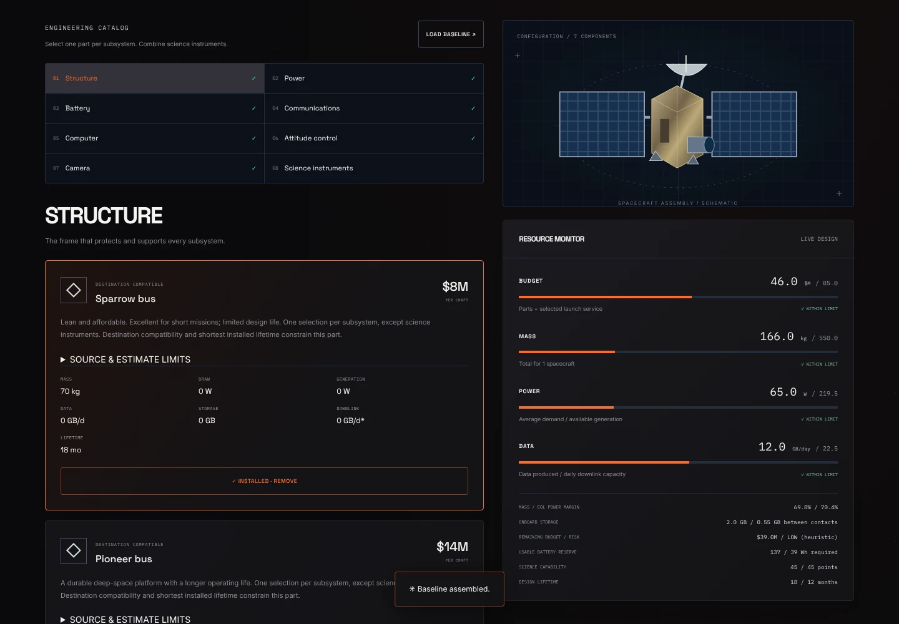
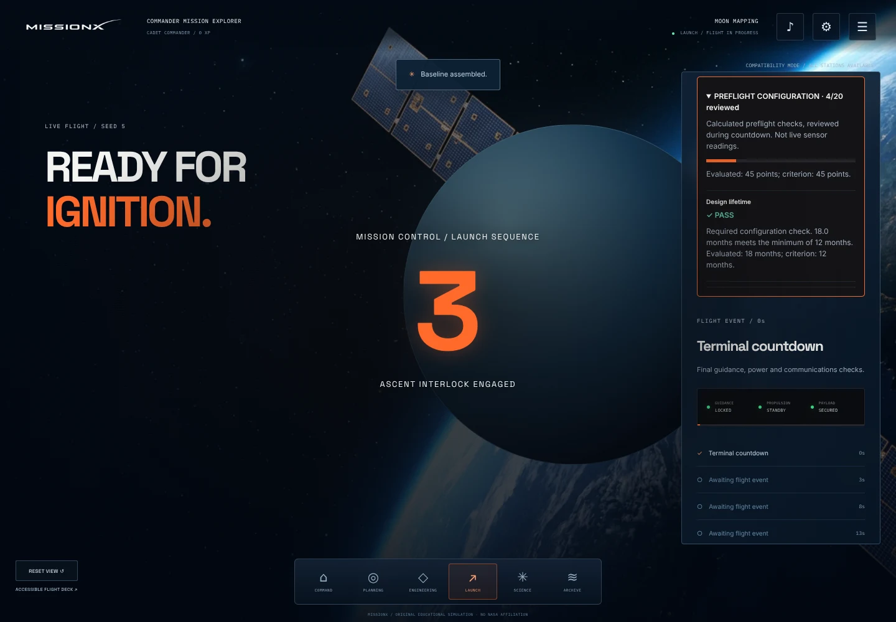
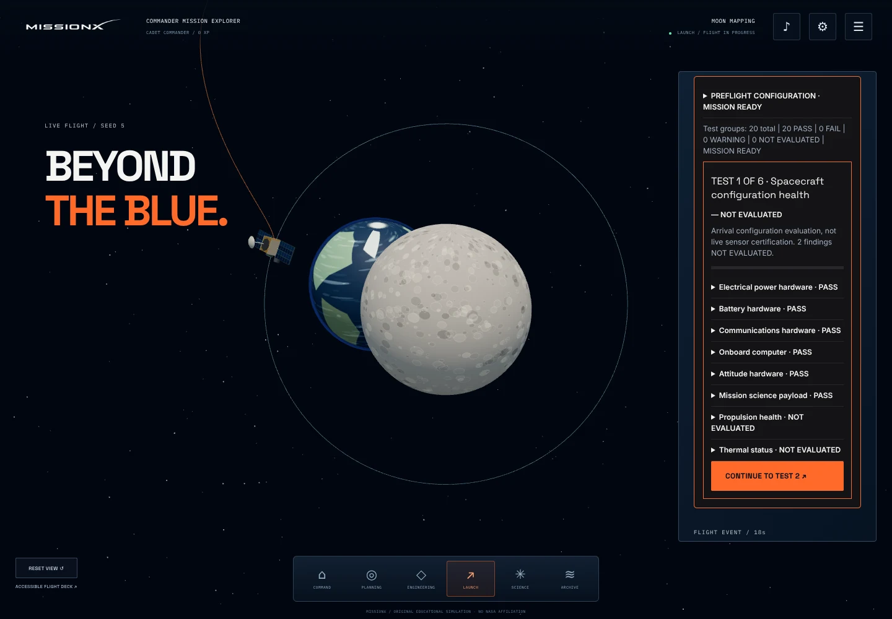
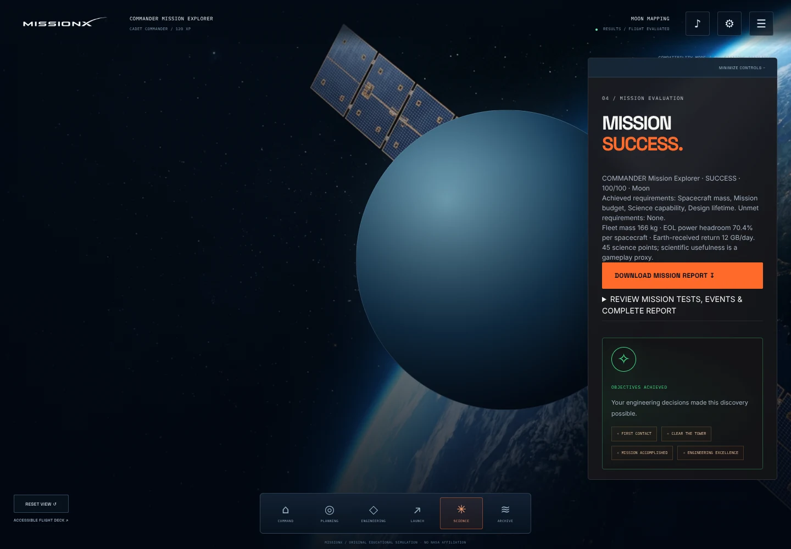
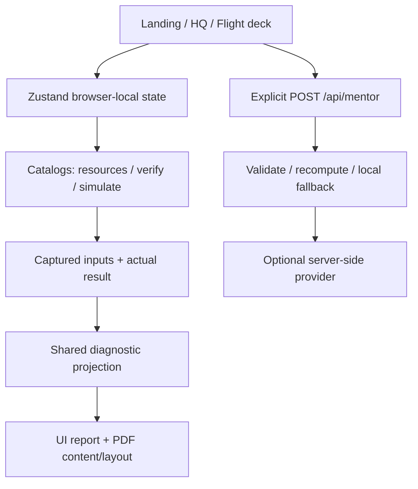

<p align="center"></p>

# MissionX — Design. Simulate. Learn.

**Design a spacecraft. Balance the trade-offs. Learn from the mission.**

MissionX is an educational browser game by **NASA WARRIORS**, developed for the **2026 NASA International Space Apps Challenge**, *Space Mission Design Game*. The event theme is **The Next Frontier**; it is not the challenge's title. Players connect science objectives, spacecraft components, resource constraints and mission outcomes through an interactive mission-design loop.

**Version:** 0.1.12 · **Status:** implemented demonstration candidate; final public-submission approval is pending. The software checks pass, but artwork/AI-content compliance, final demo, team eligibility and deployment of this exact revision still need confirmation. A dependency audit also has an open moderate tooling advisory. See the [finalization report](docs/Finalization-Report.md).

[Submission package](submission/PROJECT_OVERVIEW.md) · [Demo guide](submission/DEMO_GUIDE.md) · [Documentation](docs/README.md) · [Deployment](docs/Deployment.md)

[Existing public site](https://missionx-black.vercel.app/) · [Repository](https://github.com/ausafulislam/MissionX) · [Team page](https://www.spaceappschallenge.org/2026/find-a-team/nasa-warriors/)

The public landing page was reachable during finalization, but showed older Sun wording. **Its deployed revision is not verified as 0.1.12.** Local evidence below refers to this repository, not a claimed production rollout.

## See the application

Actual **0.1.12** captures from a local production build. HQ selection/countdown/diagnostics use compatibility mode; the journey image uses **SwiftShader software WebGL**, not a physical GPU. Builder/results use the semantic flight deck. Images are screenshots, not generated mockups. Underlying artwork rights and any required AI-content markings remain unresolved. [All ten visuals and capture conditions](docs/images/README.md).


| Configure and budget | Verify and launch |
|---|---|
|  |  |

| Schematic journey | Understand the result |
|---|---|
|  |  |

## What is implemented

| Capability | Current behavior |
|---|---|
| Mission selection | Moon Mapping, Sun Watch and Mars Orbiter; measurable mass, budget, science and lifetime requirements |
| Spacecraft builder | 26 authored parts across eight categories, compatibility/dependency checks, fictional launcher and synthetic orbit selection |
| Live engineering balance | Fleet mass/cost/data/storage/downlink; per-spacecraft solar generation/load and battery reserve; weakest-component life |
| Configuration verification | Blocking requirements plus explicit accepted warnings; this is not spacecraft certification |
| Launch lifecycle | Shared 3–2–1/LIFTOFF clock, seeded launch risk, schematic 3D journey, event timeline and pause/speed/skip controls |
| Operations and diagnostics | Finite energy/memory and received-data accounting; six sequential configuration reviews with visible NOT EVALUATED findings |
| Evaluation | SUCCESS, PARTIAL or FAILED; science/engineering/efficiency contributions and **Weighted Performance Score** |
| History and reports | Browser-local archive/comparison, captured new-run inputs, legacy reconstruction disclosure, detailed review and downloadable PDF |
| Guidance | First-use HQ tour, replay/settings, deterministic local mentor and optional remote AI advice |
| Presentation | HQ procedural 3D, semantic `/play` alternative, compatibility mode, reduced motion and gesture-enabled procedural audio |

**Not implemented:** multiplayer, cloud accounts/sync, leaderboard, Urdu localization, GMAT, live NASA APIs, real orbital propagation, measured subsystem health or an offline-installable PWA. Remote AI is optional and unverified live in this environment; gameplay does not require it. Device/accessibility coverage is limited, not certified.

## How it works

**GOAL → BUILD → VERIFY → LAUNCH → RESULT**

1. **Goal:** choose a destination and inspect requirements. Sun Watch observes the Sun **from Earth orbit**; it does not travel to the Sun.
2. **Build:** select components or load the authored baseline. Watch coupled mass, power, cost, battery and data consequences.
3. **Verify:** choose a compatible launch service/orbit; resolve blocking checks. Warnings are disclosed risks, not successful physical tests.
4. **Launch:** choose a seed and start countdown. A launch loss has no arrival credit. Successful deployment reaches six configuration reviews before science playback continues.
5. **Result:** inspect outcomes, unmet requirements, received/lost data and recommendations. Export the PDF, compare runs and redesign.

A rounded weighted score of **100 does not necessarily mean every objective was achieved**. Moon baseline seed 0 returns 44.9/45 science points, score 100 and **PARTIAL**. Outcomes remain distinct from score rounding. [Rules and limitations](docs/Launch-and-Simulation.md).

### Educational mission inputs

All values are **MissionX-authored educational estimates**, not NASA mission specifications. Budgets include fleet parts and one launch.

| Mission | Fleet | Mass limit | Budget ($M) | Science target | Required life |
|---|---:|---:|---:|---:|---:|
| Moon Mapping | 1 | 550 kg | 85 | 45 points | 12 months |
| Sun Watch | 4 identical craft | 1,000 kg | 180 | 160 points | 12 months |
| Mars Orbiter | 1 | 900 kg | 170 | 75 points | 24 months |

[Full catalog](docs/Missions.md) · [Field-level provenance](docs/DATA_SOURCES.md)

## Technology and architecture

| Layer | Actual implementation |
|---|---|
| Framework/UI | Next.js 16.4.6 App Router, React/React DOM 19.3, strict TypeScript |
| Styling/motion | Tailwind 4, scoped CSS, GSAP; Lenis on the landing page |
| 3D/audio | Three.js, React Three Fiber/Drei; procedural Web Audio |
| State/storage | Zustand; validated browser-local saves/preferences, no application database |
| Educational engine | Pure TypeScript budgeting, checks, seeded events and representative operations; not a physics SDK |
| Reporting | pdf-lib, shared engine-derived report content and measured layout |
| Optional AI | Server-side OpenAI Chat Completions HTTP request; no SDK, deterministic fallback |
| Quality/deployment | Bun test runner, ESLint, TypeScript, Next build; existing Vercel URL, no tracked provider configuration |

```text
Landing / HQ / semantic flight deck
       │ design + actions                 explicit mentor request
       ▼                                          │
Zustand stores ──► catalogs + pure engine            ▼
       │          resources → verify → simulate   /api/mentor
       │                        │                 validate/recompute
       ▼                        ▼                 local or optional AI
schema-1 captured inputs + actual result
       │
       ├──► shared diagnostic projection → UI review/counts
       └──► report content → printable review + PDF
```

```text
src/app/                 landing, /hq, /play/*, POST /api/mentor
src/components/          landing/layout, HQ/world, flight-deck/shared panels
src/game/data/           static catalogs and authored assumptions
src/game/engine/         resources, verification, operations, simulation,
                         diagnostics, lifecycle, legacy models, snapshot reader
src/game/store/          mission records and commander preferences/progression
src/game/report/         parameter provenance, score copy, report/PDF layout
src/game/audio/          procedural score/effects and lifecycle
src/game/onboarding/     tour definitions and versioned state
public/                  existing artwork and local licensed fonts
docs/                    current guides, provenance, history and evidence
submission/              judge-facing drafts and manual submission checklist
```



The engine does not import UI. Saves are local educational records, not authentication or signed telemetry. Valid schema-1 reports use captured inputs/results; snapshotless legacy saves explicitly reconstruct using current catalogs and recorded model dispatch. Supplied invalid/unknown snapshots fail closed and retain original stored data until explicit reset. Reports still use current explanatory metadata/diagnostic logic; snapshots are **not permanent executable archives**. [Current module map](docs/Components.md) · [Protected architecture baseline](docs/Architecture.md) · [Corrections](docs/Post-Audit-Corrections.md)

<a id="run-locally"></a>

## Installation and setup

Use **Bun 1.3.14** (`packageManager`), Git and a modern browser. Install Bun using its [official instructions](https://bun.sh/docs/installation); the installer itself was not run during this task. Next's installed package declares Node >=20.9 if using a Node-based hosting runtime; verify your provider's supported runtime separately.

```sh
git clone https://github.com/ausafulislam/MissionX.git
cd MissionX
bun install --frozen-lockfile
bun run dev --hostname 0.0.0.0
```

Open `http://localhost:3000` locally. In a hosted sandbox use its public preview URL. This task verified frozen installation in the existing checkout, not a separate fresh-clone machine.

```sh
bun run test
bun run lint
bun run typecheck
bun run balance
bun run build
bun run start --hostname 0.0.0.0
```

`balance` explores authored seeded designs; its percentages are not aerospace reliability or learner-outcome measurements. [Exact executed checks](docs/Testing.md).

### Configuration

No environment file is needed for normal gameplay/local advice. Optionally copy `.env.example` to `.env.local` (ignored by Git):

| Variable | Purpose |
|---|---|
| `MENTOR_API_KEY` | Server-only optional provider key; never use a `NEXT_PUBLIC_` key |
| `MENTOR_MODEL` | Optional model; defaults to `gpt-4o-mini`; provider availability is not guaranteed |
| `NEXT_PUBLIC_SITE_URL` | Reserved/unused in current source; does not configure metadata, domains or PDF links |

Only explicit mentor requests can send design/checks/recomputed result to the provider, not commander identity. Missing key/provider failure falls back locally. The route has size/seed/catalog validation and timeout but **no rate limiter**; leave the key unset until deployment abuse/cost controls are reviewed. Live provider access was not tested. [API/privacy](docs/Mentor.md) · [Security](SECURITY.md)

## Deployment and production checks

Use the Next.js framework integration, `bun install --frozen-lockfile` and `bun run build`. No static-export or standalone output is configured; the mentor needs a server route. Do not upload `.next` as a static website. Hosting settings, domains, rollback, snapshot backup and smoke checks are in [Deployment.md](docs/Deployment.md). **No deployment was performed by this finalization task.**

The dependency audit currently reports moderate **GHSA-g3hv-75wg-m249** in transitive `minimatch@10.2.6` through TypeScript/ESLint tooling. No dependency upgrade or forced override was made. Maintainer review/remediation or documented risk acceptance remains open.

## Scientific scope and credits

NASA's *Design and Develop Science Missions* is an explicit conceptual reference for mission segments/requirements; historical method adoption and numerical derivation are not established. GMAT, CML, MDL, Mission Viz, Webb/CubeSat and CSA pages are separately classified references, not integrated solvers or copied parameters. No catalog magnitude is attributed to NASA. [Source register](docs/RESOURCES.md) · [Formulas](docs/ENGINEERING_REFERENCES.md)

The model uses four representative EOL days, 48 steps/orbit, synthetic sunlight/contact windows, authored launch/event probabilities and simplified stationary lifetime extrapolation. It cannot establish real navigation, RF, propulsion, thermal, structural or calibrated instrument health. PASS means a modeled configuration check passed; unmodeled properties remain **NOT EVALUATED**. Physical-device GPU/audio, full assistive-technology review and independent scientific validation remain outstanding. [Scientific limitations](docs/Scientific-Limitations.md)

Created by **NASA WARRIORS**, Karachi, Pakistan; the public participant page identifies **Universal Event**. Member names/roles, eligibility and final approvals need owner confirmation. No awards or institutional endorsements are claimed.

## License, contribution and submission

Project-owned software/docs use the [MIT License](LICENSE), copyright 2026 Team NASA WARRIORS. Third-party code/fonts retain their own terms, including GSAP's custom license and SIL OFL fonts. Supplied artwork is **Unknown / Requires owner confirmation**; MIT is not an artwork rights grant. [Full attribution and checklist](docs/Asset-Attribution.md).

The official submission guide requires AI/SI disclosures and markings. AI-assisted development occurred in this session; the team must reconcile full code/art/audio history and any required image/video watermarks **before** attesting originality/permission. No artwork was modified to claim compliance.

[Contributing](CONTRIBUTING.md) · [Conduct](CODE_OF_CONDUCT.md) · [Security](SECURITY.md) · [Citation](CITATION.cff) · [Submission checklist](submission/SUBMISSION_CHECKLIST.md)

## Independence disclaimer

MissionX is an independent educational project created for learning and demonstration purposes. It is not affiliated with, endorsed by, or an official product of NASA.
