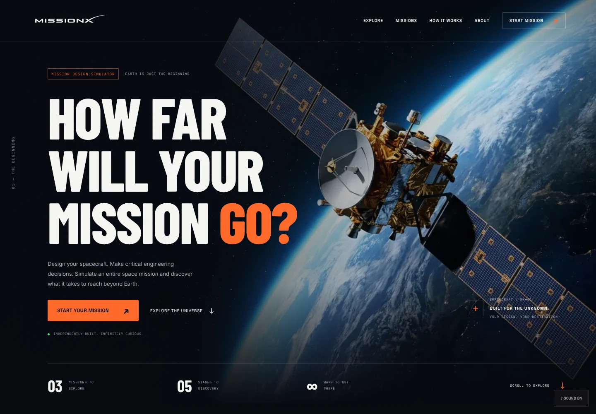
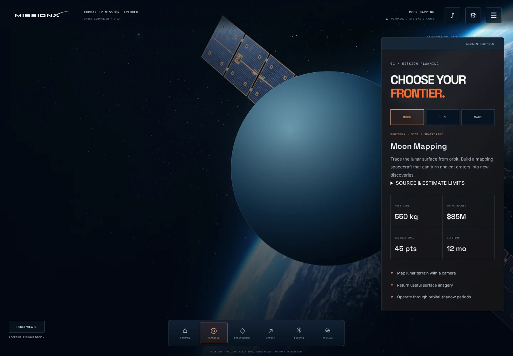
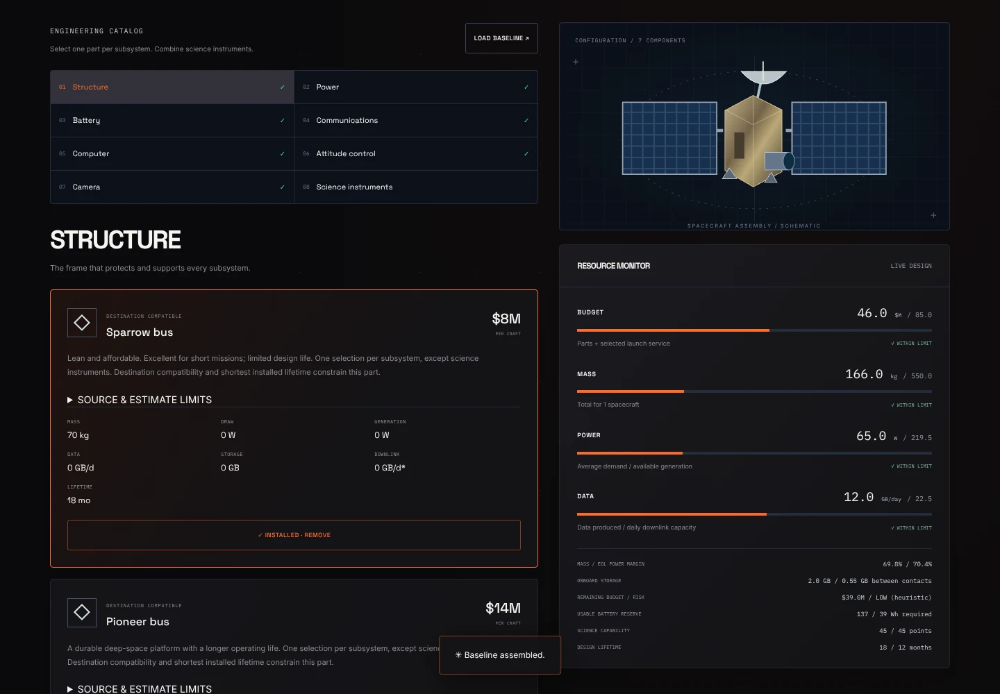
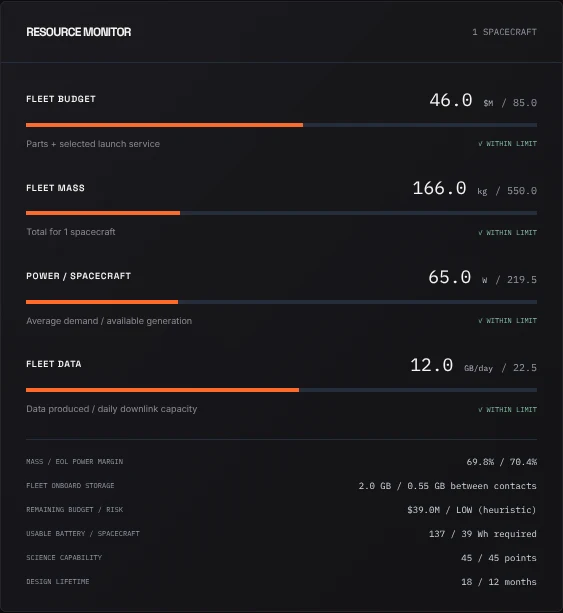
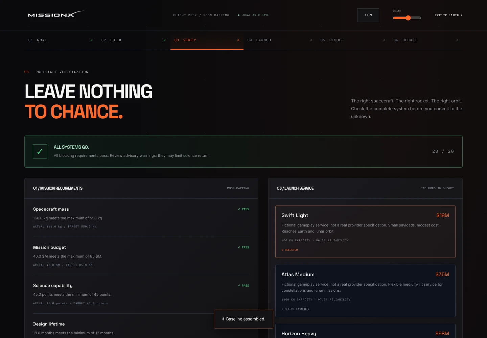
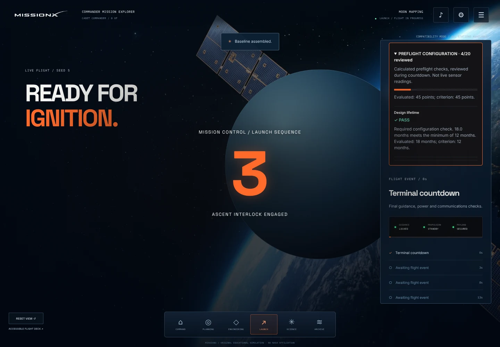
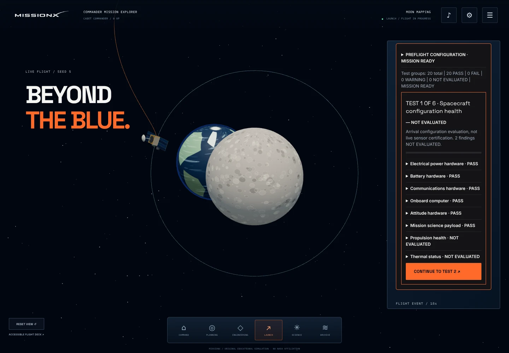
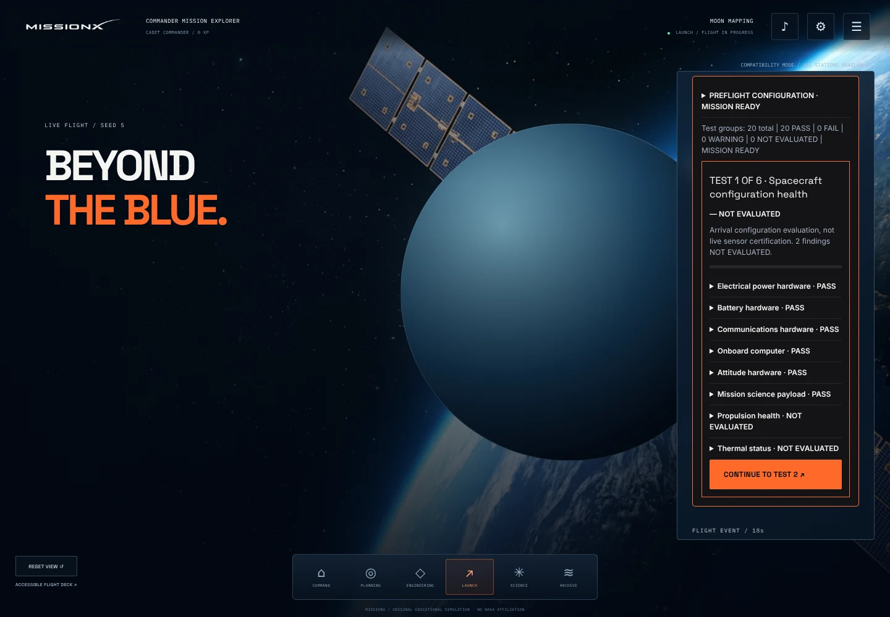
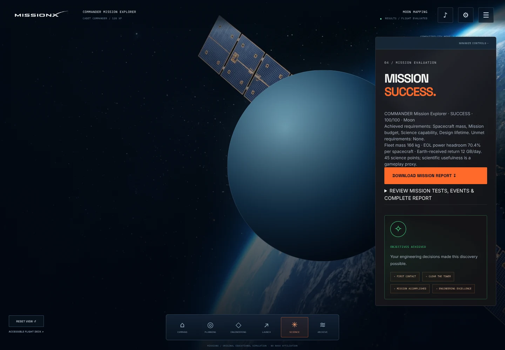
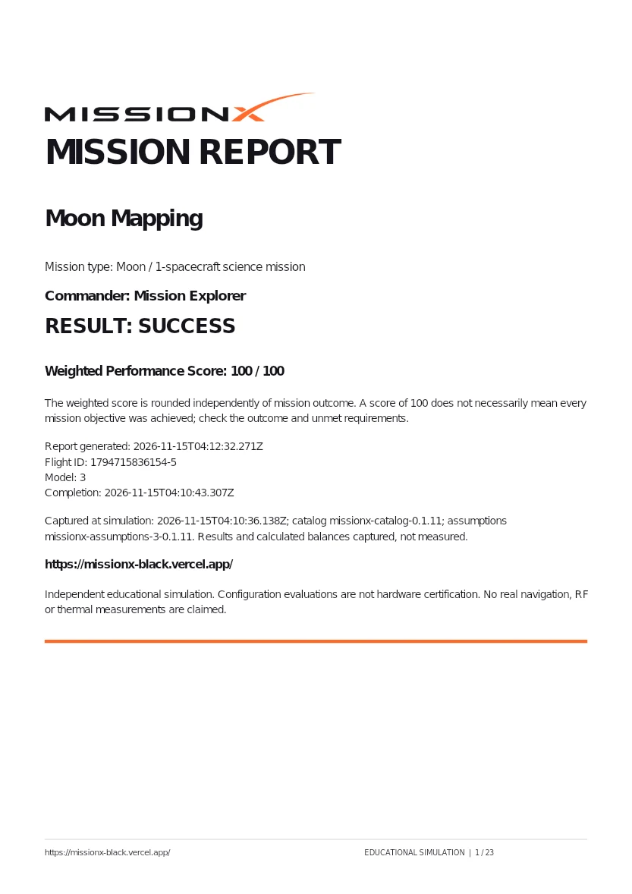

# Actual application screenshots

[Documentation index](../README.md)

Ten real0.1.12 application/report visuals captured during finalization. Chromium1440×1000/reduced motion for viewport shots. Cropped result/resource images are direct DOM screenshots; PDF preview is a render of the actual generated23-page Moon seed5 report. Capture environment timestamps read2026-11-15; task calendar is2026-11-14. Historical prior captures were replaced, not presented as fresh evidence.

HQ selection/countdown/arrival-review captures explicitly force the implemented **no-WebGL compatibility mode**. Journey capture instead used active, non-lost WebGL2 through **ANGLE/SwiftShader software Vulkan**, not a physical GPU. Builder/verification/result/resource shots use `/play`. No generated mockups, composites, fabricated sensor data or renderer/performance claims. The capture profile “Mission Explorer” is not a team identity. Baseline Moon seed5, six reviews and success were reached with real controls; the clean result crop reused that real saved run in a fresh page to avoid transient toast obstruction.

Sharp WebP quality88; existing ignored QA tooling only, no runtime dependencies added. Underlying artwork/logo/screenshot rights remain **Unknown / Requires owner confirmation**; owner must also review official SI watermark rules before external demo reuse. See [attribution](../Asset-Attribution.md).

| Visual | Mode and scope |
|---|---|
|  | Landing viewport; local production build |
|  | HQ compatibility selection |
|  | Semantic builder, scrolled to engineering layout |
|  | Actual resource-panel DOM crop |
|  | Semantic flight deck, authored baseline |
|  | HQ compatibility, three-second countdown |
|  | Software WebGL2, arrival review milestone |
|  | HQ compatibility, first of six reviews |
|  | Semantic result-hero DOM crop, actual seed5 success |
|  | Actual report page1 rendered to image; timestamp reflects environment clock |

All ten were opened for visual review; verification was recaptured using the semantic flight deck to show its complete controls. Long panels continue beyond the viewport; images do not establish full-page or assistive-technology compliance. Current wording is CONFIGURATION READY, not flight certification.
