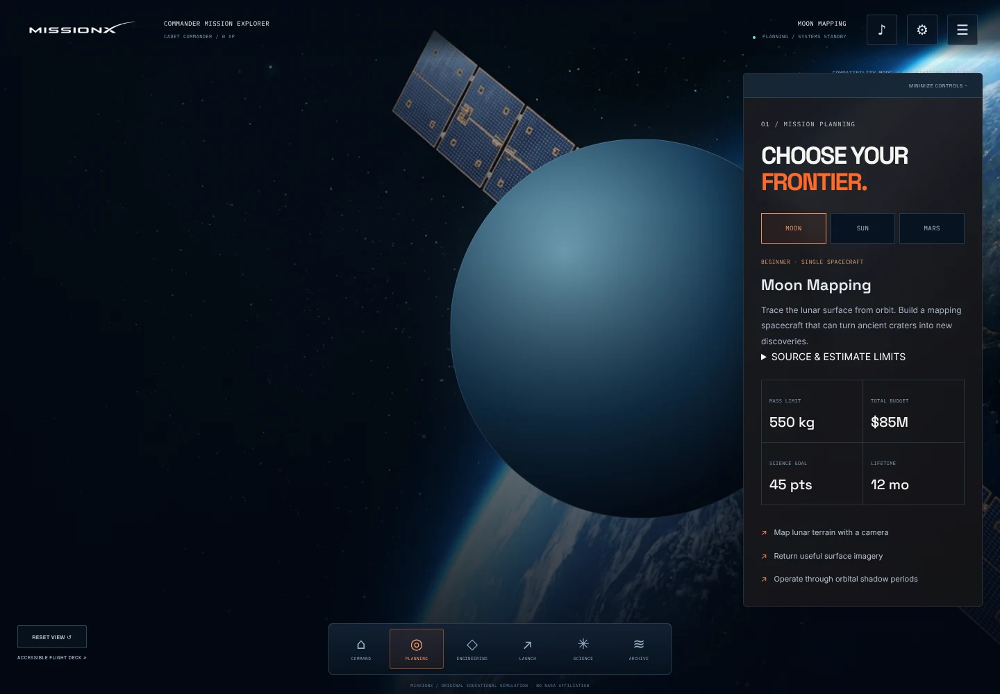
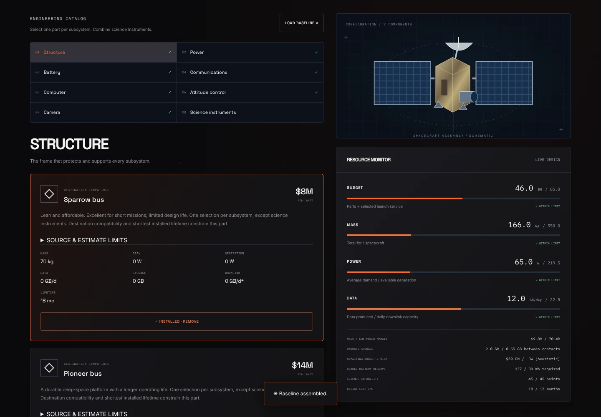
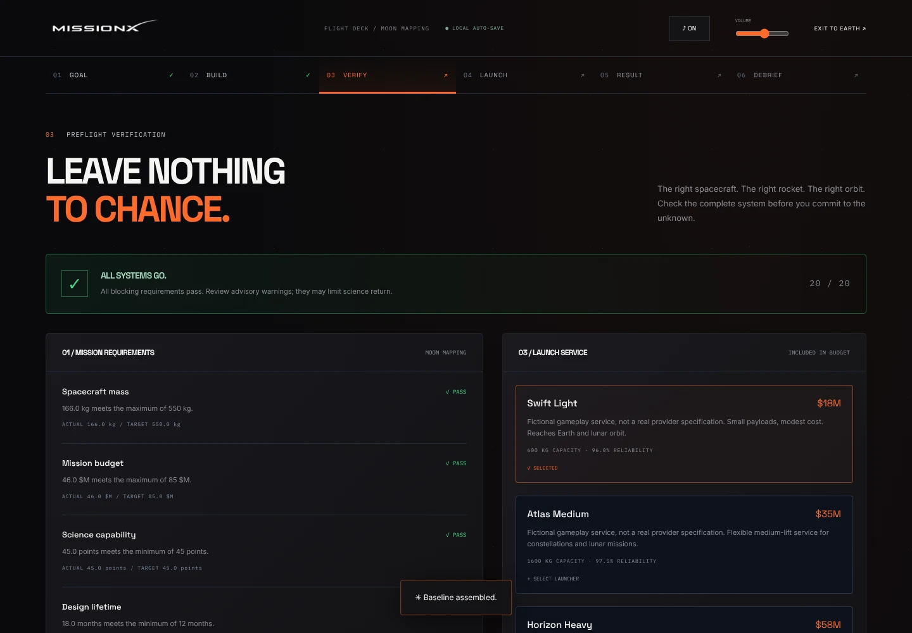
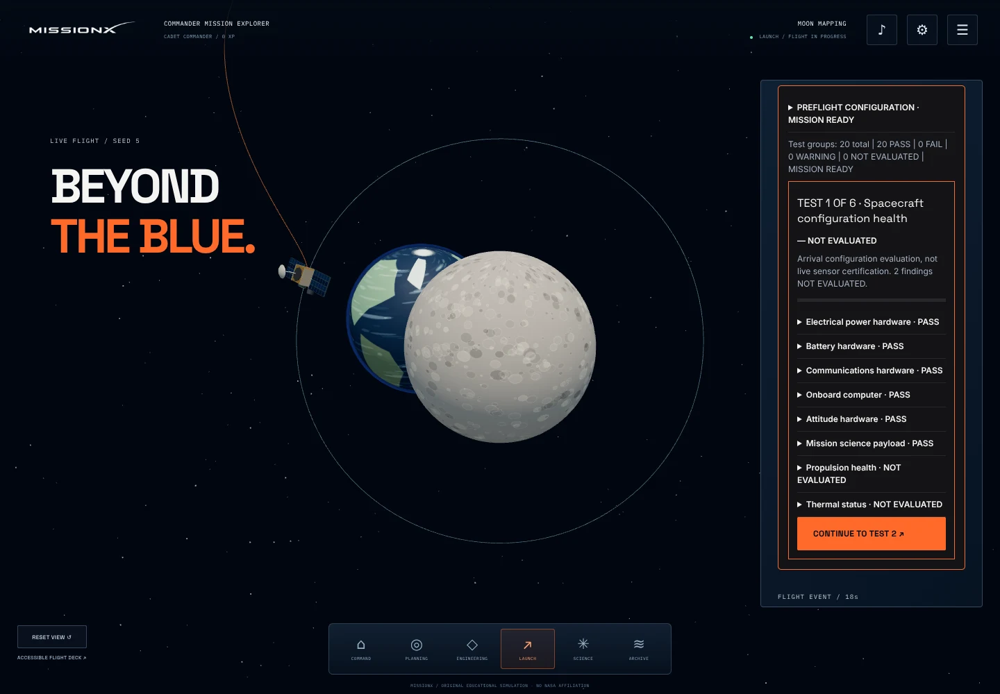
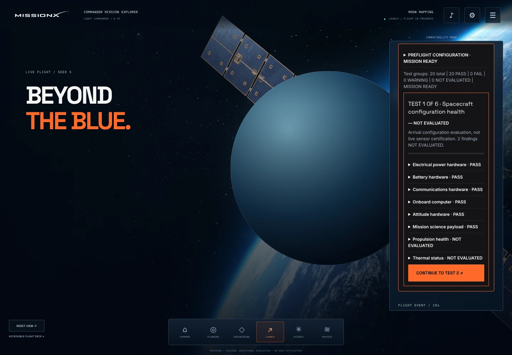
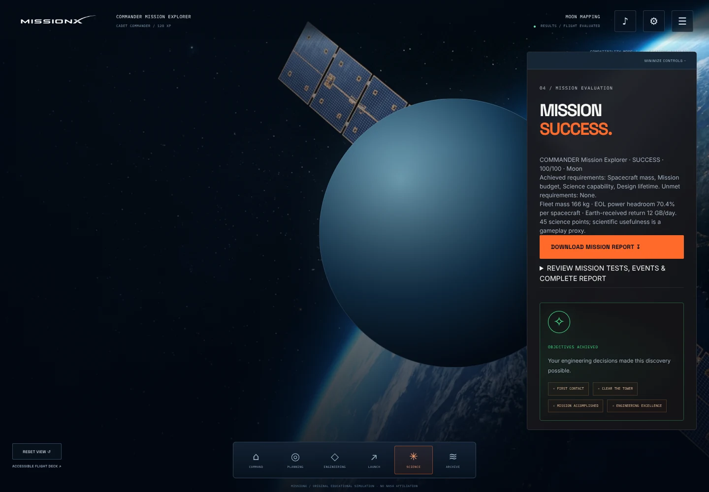

# Features and user journey

**GOAL → BUILD → VERIFY → LAUNCH → RESULT**

1. **Goal:** select Moon, Sun or Mars and inspect four measurable requirements.
2. **Build:** choose parts across eight categories or load the authored baseline. Read per-craft/fleet balances and estimate limitations.
3. **Verify:** choose fictional launcher/synthetic orbit; fix blocking checks and understand accepted warnings.
4. **Launch:** choose seed, start shared countdown and observe schematic flight. A launch loss ends without arrival credit; successful deployment reaches six diagnostic reviews before science playback.
5. **Result:** inspect outcome, weighted score, achieved/unmet requirements and four segments. Export the report, compare local history and redesign.

| Actual0.1.12 state | Screenshot |
|---|---|
| Goal selection, HQ compatibility mode |  |
| Builder and live balance, semantic flight deck |  |
| Verification, semantic flight deck |  |
| Journey/arrival, software WebGL |  |
| Arrival configuration review, compatibility mode |  |
| Evaluation, semantic flight deck |  |

[Capture provenance](../docs/images/README.md) identifies render conditions and rights limitations. These are real captures, not physical-device performance proof. Report preview: [PDF cover](../docs/images/pdf-report.webp). The long-form guide is not a substitute for the required short demo.
